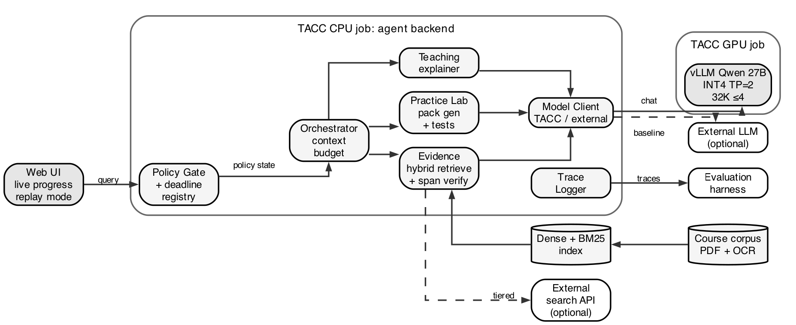

# Verifiable AI Tutoring on TACC

*A course-grounded agent with evidence-checked answers, executable practice labs, and enforced course policy*

Project repository for CSIT6000V Advanced AI Computing and Systems (Fall 2026) by LI Jinchuan, TIAN Yujia, and XIE Yifeng: a course-grounded tutoring agent built to run on TACC.

## Status

**Technology selected, model layer implemented, PRD v0.5 drafted.** The substantive content is the course project proposal, the product requirements in [docs/prd.md](docs/prd.md), the domain vocabulary in [GLOSSARY.md](GLOSSARY.md), the technology selection record, nine ADRs (including LangGraph orchestration, local Langfuse tracing, and typed agent tools), the local tracing and email runbooks, and the model layer: configuration loading, the unified DeepSeek and MiMo adapter, its pytest suite, and a live smoke script. The rest of the application, the corpus, benchmark data, and the evaluation report do not exist yet. Everything else described below as behavior is planned; planned directories appear in the layout table as `placeholder (.gitkeep)` or `planned`. Multi-course deployment is out of scope for this deliverable and is recorded as future development in the PRD.

## What it is

A tutoring agent for one course whose outputs are checkable in three ways: text claims against cited page spans, code artifacts against executable tests, and disclosure against a dated policy. The scope is deliberately narrow: this course's own materials, assignments, and deadlines. The full argument, including motivation and design rationale, is in [proposal/proposal.md](proposal/proposal.md); this README is the entry point, not a second proposal.

## Use cases

Students can:
- Ask course questions and receive answers that cite the exact page and quoted span.
- Ask by voice: record in the composer for transcription, or attach an audio file for MiMo 2.6 to analyze; play assistant answers as speech.
- Request a review outline or self-test questions on a topic; answer them and receive graded feedback with citations.
- Practise with a generated exercise at the scale and environment of the corresponding assignment, receiving a reference solution, tests, and a stepwise explanation; code answers run as TACC jobs.
- Submit their own solution and receive line-anchored teaching.

Instructors and TAs can:
- Maintain the deadline registry that drives the disclosure policy.

## Disclosure policy

A five-state policy decides what the agent may reveal. The states are pre-release, active, extension window, post-deadline, and unknown; the gate that enforces them is planned, not implemented.

| Policy state | What the agent does |
|---|---|
| Pre-release, active, extension window | Refuses complete homework solutions and offers hints. Explains a user-provided solution only at the level provided and never fills in missing parts. |
| Post-deadline | Replaces refusal with full teaching plus a verified solution. |
| Unknown | Abstains rather than guesses; insufficient evidence also leads to abstention. |

The gate is code, not a prompt: a versioned registry of release and due dates with extensions, an intent classifier, and a log of every decision. The proposal covers the policy in [section 2](proposal/proposal.md#2-task-definition-and-outputs) and [section 3](proposal/proposal.md#3-proposed-system).

## Architecture

The planned system has three moving parts: a React browser UI served by the agent backend, the agent backend (run locally for the current demo and submitted as a TACC CPU job for evaluation evidence), and a model-client abstraction over external OpenAI-compatible APIs (DeepSeek primary, Xiaomi MiMo selectable, with no automatic cross-model fallback), with the course Qwen service kept as an optional TACC baseline. The agent workflow is a LangGraph `StateGraph` ([ADR-0008](docs/adr/0008-langgraph-as-agent-orchestration-runtime.md)), and local development traces model calls and graph steps into a self-hosted Langfuse instance ([ADR-0007](docs/adr/0007-langfuse-for-local-model-call-tracing.md), [docs/langfuse-local.md](docs/langfuse-local.md)). Embeddings run locally on TACC with BGE-M3 ([ADR-0004](docs/adr/0004-hybrid-retrieval-with-bge-m3.md)). The project environment is a pinned layer installed into the user workspace; the platform does not support custom images ([ADR-0001](docs/adr/0001-pinned-python-environment-without-docker.md)).

The optional GPU job serves Qwen3.8-27B-AWQ-INT4 with vLLM at TP=2 and 32K context, admitting at most four concurrent requests, as a baseline. The primary text generation uses external APIs configured in `config/models.yaml` with keys in `.env` ([ADR-0005](docs/adr/0005-external-model-apis-as-primary.md)). The figure source is [proposal/figs/fig2_components.dot](proposal/figs/fig2_components.dot).

The six planned subsystems inside the CPU job:
- Accounts: email and password sign-in restricted to course student domains, with a verification code, password reset, scrypt hashing, and server-side sessions; a student and an instructor role. The requirements are in [docs/prd.md](docs/prd.md) and the QQ Mail procedure in [docs/email-local.md](docs/email-local.md).
- Evidence: a TACC OCR job parses PDF files, one file per request, into page records with page numbers, block boxes, reading order, and page images ([ADR-0002](docs/adr/0002-ocr-on-tacc-with-paddleocr-vl.md), [docs/corpus-schema.md](docs/corpus-schema.md)); `scripts/tacc/parse_pdf.py` runs the whole local-to-TACC round trip and returns per-page JSONL plus one document markdown; hybrid retrieval fuses SQLite FTS5 BM25 with BGE-M3 dense embeddings and an optional reranker ([ADR-0004](docs/adr/0004-hybrid-retrieval-with-bge-m3.md)); a deterministic span verifier requires every quoted span to occur on its cited page, with one repair round or abstention.
- Practice lab and self-test: generated questions in the types the student asks for or the agent chooses, with cited reference answers; reference tests and student code answers execute as TACC jobs, and the agent grades the answers with citations. The first pack is MPI/GEMM with the same toolchain, Makefile, public datasets, and an sdk-test-style harness; a generated reference solution is accepted only after it compiles and passes the pack's tests.
- Policy gate: the code-level gate described above, plus the versioned deadline registry it reads.
- Teaching explainer: cites page spans, code lines, and test outcomes, and never invents missing content before the deadline.
- Model client and trace logger: external OpenAI-compatible APIs are primary (DeepSeek, and Xiaomi MiMo when the user or config selects it, including audio). A failed call retries the selected model and then shows a timeout or unavailable message; it never switches models, configured in `config/models.yaml` with keys in `.env`; the course Qwen service is an optional baseline; every call is labelled and cached; audio-file input is supported when a MiMo 2.6 model is selected, the composer microphone uses MiMo ASR, and assistant text can be spoken with MiMo TTS ([model-providers.md](docs/model-providers.md)); traces, tests, and results follow the required execution path from task to visible result ([ADR-0005](docs/adr/0005-external-model-apis-as-primary.md)).

The browser UI is a React single-page application with shadcn and AI Elements components, served as static assets by the backend on one origin. Streaming uses the AI SDK UI message stream protocol, so the same frontend path serves live and replay sessions ([ADR-0003](docs/adr/0003-react-spa-with-ai-elements.md)). The job topology, batch windows, and demo modes are in [docs/tech-selection.md](docs/tech-selection.md#jobs-and-demo-modes).

## Repository layout

All paths are repository-relative. Planned roles are statements of intent, not descriptions of implemented behavior.

| Path | Intended role | State |
|---|---|---|
| `src/verifiable_tutor/auth/` | Accounts, authentication, sessions, and roles | planned (not created yet) |
| `src/verifiable_tutor/policy/` | Code-level disclosure gate and deadline registry | placeholder (`.gitkeep`) |
| `src/verifiable_tutor/orchestrator/` | Request routing and context budget | placeholder (`.gitkeep`) |
| `src/verifiable_tutor/evidence/` | Hybrid retrieval and deterministic span verifier | placeholder (`.gitkeep`) |
| `src/verifiable_tutor/practice/` | Practice pack generation and executable tests | placeholder (`.gitkeep`) |
| `src/verifiable_tutor/teaching/` | Line-anchored explanations | placeholder (`.gitkeep`) |
| `src/verifiable_tutor/eval/` | Evaluation harness | placeholder (`.gitkeep`) |
| `src/verifiable_tutor/corpus/` | Corpus build from OCR output: page records, chunks, page images, hashing | planned (not created yet) |
| `src/verifiable_tutor/llm/` | Model configuration loader, unified provider adapter, and file-backed response cache; replay and mock backends pending | present: config, adapter, cache |
| `src/verifiable_tutor/ui/web/` | React UI source; built assets are written to `src/verifiable_tutor/ui/static/` | planned (not created yet) |
| `tacc/serve/` | Optional baseline: TACC GPU job for the Qwen service | placeholder (`.gitkeep`) |
| `tacc/env-spike/` | Committed CPU spike: environment bootstrap, FTS5, and platform checks | present: spike job |
| `tacc/ocr-smoke/` | Committed GPU spike: PaddleOCR-VL smoke on representative pages | present: spike job |
| `tacc/pdf-parse/` | Committed GPU job: parses one complete PDF file end to end (enumerate, render, layout, recognition, document markdown) | present: demo path spike |
| `tacc/ocr/` | TACC GPU job for page rendering, layout, and OCR | planned (not created yet) |
| `tacc/index/` | TACC GPU job for embeddings and the BM25 index | planned (not created yet) |
| `tacc/exec/` | TACC CPU job that runs reference tests and self-test code answers | planned (not created yet) |
| `tacc/client/` | TACC CPU job for the agent backend, the UI, and the evaluation harness | placeholder (`.gitkeep`) |
| `benchmarks/questions/`, `benchmarks/policy_scenarios/`, `benchmarks/results/` | Course questions, policy scenarios, recorded results | placeholder (`.gitkeep`) |
| `data/corpus/`, `data/index/`, `data/caches/` | OCR output and page images, dense plus BM25 index, cached embeddings and retrieval snapshots | placeholder (`.gitkeep`) |
| `config/` | Runtime configuration: `models.yaml` owns provider endpoints, model ids, roles, request parameters, cache, and embedding settings | present: model config |
| `scripts/` | Utility scripts: TACC bootstrap, submit helper, shared OCR stage helpers, the local PDF parse request interface, and the live model smoke | present: scripts |
| `tests/` | Test suite under `tests/llm/` (configuration, chat, streaming, transcription, search, fetch) | present: tests |
| `pyproject.toml`, `uv.lock` | Python packaging, dependencies, pytest configuration, and locked local environment | present: packaging |
| `examples/` | Usage examples | placeholder (`.gitkeep`) |
| `docs/figures/` | PRD diagram sources and renders (use case, containers, sequence examples, ER), and future report figures | present: PRD diagrams |
| `docs/prd.md` | Product requirements, scope, acceptance criteria, and milestones | present: PRD |
| `GLOSSARY.md` | Domain vocabulary used across the docs and code | present: glossary |
| `docs/tech-selection.md`, `docs/adr/` | Technology decisions and the ADRs that argue them | present: decisions |
| `docs/corpus-schema.md` | Field-level contract for page, block, document and chunk records | present: schema |
| `docs/paddleocr-vl-api.md` | PaddleOCR-VL request and response construction across the local, serving, and hosted paths | present: API notes |
| `docs/langfuse-local.md` | Local development tracing runbook | present: runbook |
| `docs/email-local.md` | Registration and reset email runbook | present: runbook |
| `docs/tacc-notes.md` | Platform constraints, budgets, and mechanics | present: notes |
| `proposal/` | Proposal sources: `proposal.md`, `build_proposal.py`, figure `.dot` sources, rendered PDF and DOCX | present: proposal sources |

## Evaluation plan

All evaluation work is planned and the repository contains no results. Four research questions, detailed in [proposal section 4](proposal/proposal.md#4-evaluation-plan):

- RQ1 evidence fidelity: citation span accuracy (deterministic) and faithfulness (human-checked support rate).
- RQ2 practice and self-test verifiability: the share of generated questions whose reference answer compiles and passes course-style tests, environment alignment, cost per question, and grading consistency on a small constructed sample.
- RQ3 disclosure correctness: behavior across the five policy states, including a deadline extension, and an adversarial set (false "deadline passed" claims, TA impersonation, role-play, pasted "official" solutions) against a prompt-only baseline.
- RQ4 cost: end-to-end latency, model calls per request, and a retrieval ablation over BM25, dense, and hybrid variants.

The benchmark is planned to hold fifty course questions, ten policy scenarios, and two practice packs, with later-released sessions held out; runs use temperature 0, cached retrieval snapshots and responses, and an injected clock.

## Roadmap

The four one-week workstreams from proposal Table 1 (planned):

| Workstream | W1 | W2 | W3 | W4 |
|---|---|---|---|---|
| Corpus and OCR pipeline | X | | | |
| Hybrid index and retrieval | X | X | | |
| Span verifier | | X | | |
| Policy engine and registry | | X | X | |
| Practice pack and tests | | | X | |
| Explainer | | | X | |
| UI and replay mode | | | X | X |
| Evaluation, report, demo | | | | X |

Deliverables: the code repository, the evaluation report, and the demo.

Multi-course support is out of scope for this deliverable and is recorded as future development in [docs/prd.md](docs/prd.md#future-development).

## Documentation

- [proposal/proposal.md](proposal/proposal.md): readable Markdown text of the proposal, generated by `proposal/build_proposal.py`.
- [docs/prd.md](docs/prd.md): product requirements, scope, acceptance criteria, and milestones.
- [GLOSSARY.md](GLOSSARY.md): the project's domain vocabulary.
- [CSIT6000V_Project_Proposal_2026F_LI_TIAN_XIE.pdf](proposal/CSIT6000V_Project_Proposal_2026F_LI_TIAN_XIE.pdf): the two-page submitted PDF.
- [CSIT6000V_Project_Proposal_2026F_LI_TIAN_XIE.docx](proposal/CSIT6000V_Project_Proposal_2026F_LI_TIAN_XIE.docx): editable DOCX version.
- [docs/figures/](docs/figures/): PRD diagram sources (`.dot`) and rendered PNGs: use cases, containers, sequence examples, and the entity relationship model.
- [docs/tech-selection.md](docs/tech-selection.md): technology choices, job topology, demo modes, and the week-one verification spikes.
- [docs/corpus-schema.md](docs/corpus-schema.md): page, block, document and chunk record fields produced by the OCR pipeline.
- [docs/paddleocr-vl-api.md](docs/paddleocr-vl-api.md): PaddleOCR-VL request and response construction for the local pipeline, the recognition service, the self-hosted parsing service, and the hosted official API.
- [docs/model-providers.md](docs/model-providers.md): agent-facing API notes for DeepSeek and Xiaomi MiMo, model switching, image and audio input, thinking control, web search, JSON output, and tool calling.
- [docs/adr/](docs/adr/): decision records for the environment, the OCR pipeline, the UI stack, the retrieval model, the model backend, retry behaviour, local model-call tracing, the orchestration runtime, and typed agent tools.
- [docs/langfuse-local.md](docs/langfuse-local.md): runbook for the optional local Langfuse instance used for development tracing.
- [docs/email-local.md](docs/email-local.md): runbook for registration and password reset email over QQ Mail SMTP.
- [config/models.yaml](config/models.yaml): provider endpoints, model ids, role routing, request parameters, and embedding settings. Secrets stay in the ignored `.env`; [.env.example](.env.example) is the committed template.
- [docs/tacc-notes.md](docs/tacc-notes.md): platform constraints, budgets, and measured platform mechanics.
- [AGENTS.md](AGENTS.md): agent and contributor guide covering sources of truth, commands, and conventions.

## Team

- LI Jinchuan (21188271)
- TIAN Yujia (21201619)
- XIE Yifeng (21322152)

CSIT6000V Advanced AI Computing and Systems, Fall 2026. Instructor: Prof. Kai Chen. Proposal dated October 27, 2026. Repository: https://github.com/Kane-LI-0114/verifiable-tutor
