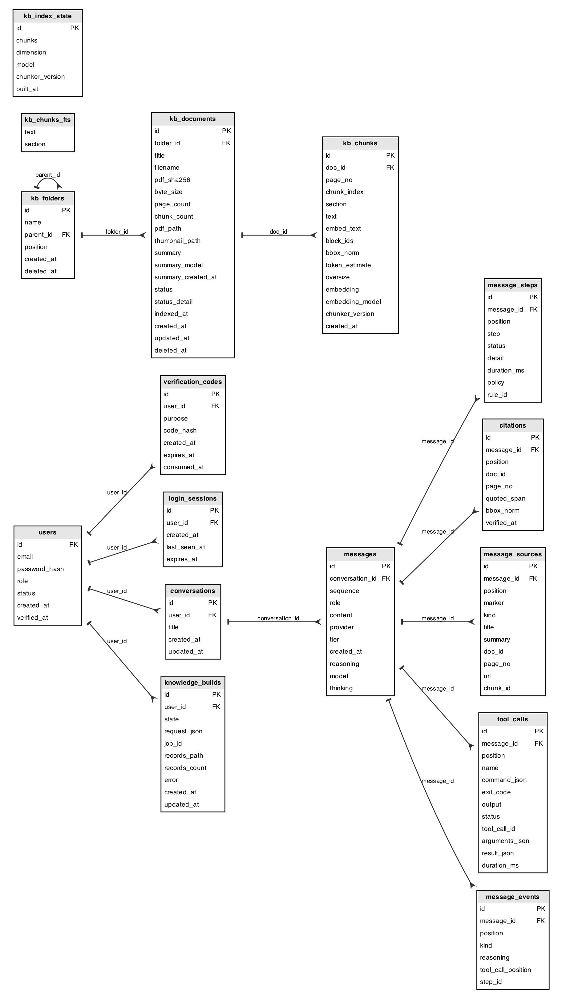

<!-- Generated by scripts/build_data_model.py from the Storage schema; do not edit. -->

# Physical data model (SQLite)

This page describes the physical SQLite schema the local backend actually
creates. It is generated by creating a temporary database from
`Storage.initialize` and reading SQLite's catalog, so it lists columns,
types, keys, foreign keys, unique constraints, and checks exactly as the
running code defines them.

It complements, and is deliberately separate from, the logical model in
[prd.md](prd.md): PRD Figure 6 ([source](figures/prd-er.dot),
[render](figures/prd-er.png)) is the intended domain model and includes
tables that do not exist yet, while this page is the implemented schema.



## Logical model versus physical model

The logical model draws these entities: `USER`, `SESSION`, `CONVERSATION`, `MESSAGE`, `CITATION`, `WORK_STEP`, `TOOL_CALL`, `DOCUMENT`, `PAGE`, `CHUNK`, `ASSIGNMENT`, `POLICY_DECISION`, `PRACTICE_PACK`, `QUESTION`, `REFERENCE_CITATION`, `ANSWER`, `GRADE_RESULT`, `EXEC_JOB`, `KB_BUILD`, `KNOWLEDGE_CARD`.

Not implemented as tables yet: `PAGE`, `ASSIGNMENT`, `POLICY_DECISION`, `PRACTICE_PACK`, `QUESTION`, `REFERENCE_CITATION`, `ANSWER`, `GRADE_RESULT`, `EXEC_JOB`, `KB_BUILD`, `KNOWLEDGE_CARD`.

Differences worth knowing when comparing the two:

- The logical `USER` is `users`, with `verified_at` instead of
  `email_verified_at`; the physical schema also has `verification_codes`
  and `login_sessions`, which the logical model folds into `SESSION`.
- The logical `MESSAGE` is `messages`; the physical row also stores
  `provider`, `tier`, `reasoning`, `model`, and `thinking`, and the work
  chain is normalized into `message_steps` and `tool_calls` rather than
  derived from the stream.
- The logical `CITATION` is `citations`, with the column name `doc_id`
  rather than `document_id`, and an added `bbox_norm` highlight box.
- The logical `DOCUMENT` is `kb_documents`, the logical `CHUNK` is
  `kb_chunks`, and `kb_chunks_fts` is the full-text index over the chunk
  text; `kb_folders` holds the browser's folder tree and `kb_index_state`
  is the single row the vector cache is keyed by.
- The logical `KB_BUILD` is a single state row, `knowledge_builds`;
  `KNOWLEDGE_CARD` and `PAGE` are not stored in SQLite yet.
- The disclosure gate and practice tables are not implemented, so their
  logical entities have no physical counterpart.

## Tables

### users

Student and instructor accounts; passwords are scrypt hashes.

| Column | Type | Null | Key | Notes |
|---|---|---|---|---|
| `id` | TEXT | yes | PK | Internal user id (uuid hex). |
| `email` | TEXT | no | - | Normalized student or instructor email address. |
| `password_hash` | TEXT | no | - | scrypt hash with a per-password salt. |
| `role` | TEXT | no | - | student or instructor. |
| `status` | TEXT | no | - | pending, active, or disabled. |
| `created_at` | TEXT | no | - | ISO-8601 UTC account creation time. |
| `verified_at` | TEXT | yes | - | Email verification time; null while the account pends. |

Checks:

- `CHECK (role IN ('student', 'instructor'))`
- `CHECK (status IN ('pending', 'active', 'disabled'))`

Indexes:

- UNIQUE (`email`)

### verification_codes

One open email verification or password reset code per purpose; the code itself is stored hashed.

| Column | Type | Null | Key | Notes |
|---|---|---|---|---|
| `id` | TEXT | yes | PK | Code row id (uuid hex). |
| `user_id` | TEXT | no | FK | Account the code belongs to. |
| `purpose` | TEXT | no | - | verify or reset. |
| `code_hash` | TEXT | no | - | Hashed six digit code or one-time reset token. |
| `created_at` | TEXT | no | - | ISO-8601 UTC creation time. |
| `expires_at` | TEXT | no | - | ISO-8601 UTC expiry time. |
| `consumed_at` | TEXT | yes | - | When the code was used; null while it is still open. |

Checks:

- `CHECK (purpose IN ('verify', 'reset'))`

Foreign keys:

- `user_id` -> `users.id` (ON DELETE CASCADE)

Indexes:

- `idx_codes_hash`: index on (`purpose`, `code_hash`)
- `idx_codes_user`: index on (`user_id`, `purpose`)

### login_sessions

Server-side browser sessions; the cookie carries an opaque token, not account data.

| Column | Type | Null | Key | Notes |
|---|---|---|---|---|
| `id` | TEXT | yes | PK | Opaque server-side session token. |
| `user_id` | TEXT | no | FK | Signed-in account. |
| `created_at` | TEXT | no | - | ISO-8601 UTC sign-in time. |
| `last_seen_at` | TEXT | no | - | Anchors the seven-day sliding expiry. |
| `expires_at` | TEXT | no | - | ISO-8601 UTC expiry time. |

Foreign keys:

- `user_id` -> `users.id` (ON DELETE CASCADE)

Indexes:

- `idx_login_sessions_user`: index on (`user_id`)

### conversations

One user-visible conversation. The HTTP API calls it a session.

| Column | Type | Null | Key | Notes |
|---|---|---|---|---|
| `id` | TEXT | yes | PK | Conversation id used as session_id in the HTTP API. |
| `user_id` | TEXT | no | FK | Owner of the conversation. |
| `title` | TEXT | yes | - | First 60 characters of the first message; null when empty. |
| `created_at` | TEXT | no | - | ISO-8601 UTC creation time. |
| `updated_at` | TEXT | no | - | Last activity; orders the sidebar newest first. |

Foreign keys:

- `user_id` -> `users.id` (ON DELETE CASCADE)

Indexes:

- `idx_conversations_user`: index on (`user_id`, `updated_at`)

### messages

Ordered conversation messages. Assistant rows carry the answer text and the turn scalars; list-shaped turn metadata lives in the four child tables below.

| Column | Type | Null | Key | Notes |
|---|---|---|---|---|
| `id` | TEXT | yes | PK | Message id; equals the streamed start messageId for answers written after turn metadata shipped. |
| `conversation_id` | TEXT | no | FK | Conversation the message belongs to. |
| `sequence` | INTEGER | no | - | 1-based order inside the conversation. |
| `role` | TEXT | no | - | user or assistant; the check also allows system, nothing writes it. |
| `content` | TEXT | no | - | Question or answer text. |
| `provider` | TEXT | yes | - | Request-time model provider for assistant rows. |
| `tier` | TEXT | yes | - | Request-time model tier for assistant rows. |
| `created_at` | TEXT | no | - | ISO-8601 UTC creation time. |
| `reasoning` | TEXT | yes | - | Streamed model thinking; null when the model produced none. |
| `model` | TEXT | yes | - | Resolved model id, for example deepseek-flash. |
| `thinking` | TEXT | yes | - | Effective thinking level: off, low, high, or max. |

Checks:

- `CHECK (role IN ('system', 'user', 'assistant'))`

Foreign keys:

- `conversation_id` -> `conversations.id` (ON DELETE CASCADE)

Indexes:

- `idx_messages_conversation`: index on (`conversation_id`, `sequence`)
- UNIQUE (`conversation_id`, `sequence`)

### message_steps

Ordered work-chain steps of one assistant answer (FR-B9). Live answers currently record the generate step only.

| Column | Type | Null | Key | Notes |
|---|---|---|---|---|
| `id` | TEXT | yes | PK | Step row id (uuid hex). |
| `message_id` | TEXT | no | FK | Assistant message the step belongs to. |
| `position` | INTEGER | no | - | 0-based display order inside the work chain. |
| `step` | TEXT | no | - | understand, retrieve, verify, decide, generate, or cite. |
| `status` | TEXT | no | - | pending, started, done, or failed. |
| `detail` | TEXT | yes | - | Optional line shown under the step. |
| `duration_ms` | INTEGER | yes | - | Measured step duration when the frame carries it. |
| `policy` | TEXT | yes | - | Disclosure state carried by the decide step. |
| `rule_id` | TEXT | yes | - | Deadline-registry rule that decided the step. |

Checks:

- `CHECK (step IN ('understand', 'retrieve', 'verify', 'decide', 'generate', 'cite'))`
- `CHECK (status IN ('pending', 'started', 'done', 'failed'))`
- `CHECK (policy IS NULL OR policy IN ( 'pre-release', 'active', 'extension-window', 'post-deadline', 'unknown' ))`

Foreign keys:

- `message_id` -> `messages.id` (ON DELETE CASCADE)

Indexes:

- UNIQUE (`message_id`, `position`)

### citations

Quoted page spans cited by one assistant answer. The table is ready but empty until the span verifier emits verified citations.

| Column | Type | Null | Key | Notes |
|---|---|---|---|---|
| `id` | TEXT | yes | PK | Citation row id (uuid hex). |
| `message_id` | TEXT | no | FK | Assistant message the citation supports. |
| `position` | INTEGER | no | - | 0-based display order inside the answer. |
| `doc_id` | TEXT | no | - | Course document id; matches the corpus image path segment. |
| `page_no` | INTEGER | no | - | 1-based page number the quoted span appears on. |
| `quoted_span` | TEXT | no | - | Exact text from the page; a citation without a span is invalid. |
| `bbox_norm` | TEXT | yes | - | JSON [x1, y1, x2, y2] normalized page box for the evidence panel. |
| `verified_at` | TEXT | yes | - | Deterministic span-verifier pass time; null until verified. |

Foreign keys:

- `message_id` -> `messages.id` (ON DELETE CASCADE)

Indexes:

- UNIQUE (`message_id`, `position`)

### message_sources

Numbered sources one assistant answer retrieved, in citation-marker order. A course source points at one document page and a web source at one URL. The row is the unverified source a marker refers to, not a verified citation.

| Column | Type | Null | Key | Notes |
|---|---|---|---|---|
| `id` | TEXT | yes | PK | Source row id (uuid hex). |
| `message_id` | TEXT | no | FK | Assistant message whose answer cites the source. |
| `position` | INTEGER | no | - | 0-based display order inside the turn. |
| `marker` | INTEGER | no | - | 1-based citation number the answer uses as [n]. |
| `kind` | TEXT | no | - | course or web. |
| `title` | TEXT | no | - | Course document title or web page title. |
| `summary` | TEXT | no | - | Fixed-length excerpt of the retrieved page or web result. |
| `doc_id` | TEXT | yes | - | Course document id; null for a web source. |
| `page_no` | INTEGER | yes | - | 1-based course page number; null for a web source. |
| `url` | TEXT | yes | - | Web source URL without the fragment; null for a course source. |
| `chunk_id` | TEXT | yes | - | Retrieved chunk id that introduced the source, when known. |

Checks:

- `CHECK (kind IN ('course', 'web'))`
- `CHECK ((kind = 'course' AND doc_id IS NOT NULL AND page_no IS NOT NULL AND url IS NULL) OR (kind = 'web' AND url IS NOT NULL AND doc_id IS NULL AND page_no IS NULL))`

Foreign keys:

- `message_id` -> `messages.id` (ON DELETE CASCADE)

Indexes:

- UNIQUE (`message_id`, `position`)
- UNIQUE (`message_id`, `marker`)

### tool_calls

Typed tool calls of one assistant answer with the provider call id, parsed arguments, a structured result, command line, exit code, duration, and truncated output (FR-H3, ADR-0016).

| Column | Type | Null | Key | Notes |
|---|---|---|---|---|
| `id` | TEXT | yes | PK | Tool-call row id (uuid hex). |
| `message_id` | TEXT | no | FK | Assistant message the call belongs to. |
| `position` | INTEGER | no | - | 0-based display order inside the answer. |
| `name` | TEXT | no | - | Typed tool name. |
| `command_json` | TEXT | yes | - | JSON argument vector of the exact command line. |
| `exit_code` | INTEGER | yes | - | Process exit code; null while running. |
| `output` | TEXT | yes | - | Truncated tool output. |
| `status` | TEXT | no | - | running, done, or failed. |
| `tool_call_id` | TEXT | yes | - | Provider tool call id the result is correlated with; null on legacy rows. |
| `arguments_json` | TEXT | yes | - | JSON object of the parsed tool arguments. |
| `result_json` | TEXT | yes | - | JSON structured result the tool returned to the model. |
| `duration_ms` | INTEGER | yes | - | Tool execution time in milliseconds when known. |

Checks:

- `CHECK (status IN ('running', 'done', 'failed'))`

Foreign keys:

- `message_id` -> `messages.id` (ON DELETE CASCADE)

Indexes:

- UNIQUE (`message_id`, `position`)

### message_events

Ordered work-chain events of one assistant answer (ADR-0017): a reasoning segment from one model call, or a reference to one row in `tool_calls`. Each event also references the work-chain step row it belongs to so the UI can group events into step sections (ADR-0019). The order is the order the model produced them.

| Column | Type | Null | Key | Notes |
|---|---|---|---|---|
| `id` | TEXT | yes | PK | Event row id (uuid hex). |
| `message_id` | TEXT | no | FK | Assistant message the event belongs to. |
| `position` | INTEGER | no | - | 0-based order inside the work chain. |
| `kind` | TEXT | no | - | reasoning or tool_call. |
| `reasoning` | TEXT | yes | - | Reasoning text for a reasoning event; null for a tool call. |
| `tool_call_position` | INTEGER | yes | - | Position of the referenced tool_calls row; null for reasoning. |
| `step_id` | TEXT | yes | - | Work-chain step row id the event belongs to; null on legacy rows. |

Checks:

- `CHECK (kind IN ('reasoning', 'tool_call'))`
- `CHECK ((kind = 'reasoning' AND reasoning IS NOT NULL AND tool_call_position IS NULL) OR (kind = 'tool_call' AND tool_call_position IS NOT NULL))`

Foreign keys:

- `message_id` -> `messages.id` (ON DELETE CASCADE)

Indexes:

- `idx_message_events_message`: index on (`message_id`, `position`)
- UNIQUE (`message_id`, `position`)

### knowledge_builds

State of one submitted Qwen knowledge-base build.

| Column | Type | Null | Key | Notes |
|---|---|---|---|---|
| `id` | TEXT | yes | PK | Build id. |
| `user_id` | TEXT | no | FK | Instructor or TA who started the build. |
| `state` | TEXT | no | - | queued, running, ready, or failed. |
| `request_json` | TEXT | no | - | Validated build request JSON. |
| `job_id` | TEXT | yes | - | TACC job id when submitted. |
| `records_path` | TEXT | yes | - | Local validated records JSONL. |
| `records_count` | INTEGER | yes | - | Number of valid records downloaded. |
| `error` | TEXT | yes | - | Failure message when the state is failed. |
| `created_at` | TEXT | no | - | ISO-8601 UTC creation time. |
| `updated_at` | TEXT | no | - | ISO-8601 UTC last update time. |

Checks:

- `CHECK (state IN ('queued', 'running', 'ready', 'failed'))`

Foreign keys:

- `user_id` -> `users.id` (ON DELETE CASCADE)

Indexes:

- `idx_knowledge_builds_state`: index on (`state`, `created_at`)

### kb_folders

Folder tree the knowledge-base browser shows. A document belongs to one folder or to the root when `folder_id` is null.

| Column | Type | Null | Key | Notes |
|---|---|---|---|---|
| `id` | TEXT | yes | PK | Folder id (12 hex characters). |
| `name` | TEXT | no | - | Display name; unique among the siblings of one parent. |
| `parent_id` | TEXT | yes | FK | Parent folder; null for a root folder. |
| `position` | INTEGER | no | - | Sort order among the siblings of one parent. |
| `created_at` | TEXT | no | - | ISO-8601 UTC creation time. |
| `deleted_at` | TEXT | yes | - | ISO-8601 UTC soft-delete stamp; null while the folder is visible. |

Foreign keys:

- `parent_id` -> `kb_folders.id` (ON DELETE CASCADE)

Indexes:

- `idx_kb_folders_parent`: index on (`parent_id`)
- UNIQUE (`parent_id`, `name`)

### kb_documents

One row per course document: the source PDF, its metadata, the Qwen AI summary, and the ingestion status the browser renders.

| Column | Type | Null | Key | Notes |
|---|---|---|---|---|
| `id` | TEXT | yes | PK | Document id, the PDF stem. Matches `doc_id` in chunk ids and citations. |
| `folder_id` | TEXT | yes | FK | Folder the file sits in; null means the root. |
| `title` | TEXT | no | - | Display title the browser shows. |
| `filename` | TEXT | no | - | Original PDF file name. |
| `pdf_sha256` | TEXT | no | - | SHA-256 of the source PDF; the ingestion idempotency key. |
| `byte_size` | INTEGER | yes | - | Source PDF size in bytes. |
| `page_count` | INTEGER | no | - | Pages the OCR pipeline parsed. |
| `chunk_count` | INTEGER | no | - | Chunks stored for this document. |
| `pdf_path` | TEXT | no | - | Local mirror path of the source PDF served by the preview. |
| `thumbnail_path` | TEXT | yes | - | First-page WebP used as the file tile icon. |
| `summary` | TEXT | yes | - | Qwen document summary; null until the summary job lands. |
| `summary_model` | TEXT | yes | - | Model that wrote the summary. |
| `summary_created_at` | TEXT | yes | - | ISO-8601 UTC time the summary was written. |
| `status` | TEXT | no | - | uploading, uploaded, upload_failed, processing, ready, or failed. |
| `status_detail` | TEXT | yes | - | Failure reason or progress note shown in the tile title. |
| `indexed_at` | TEXT | yes | - | ISO-8601 UTC time the chunks and vectors were stored. |
| `created_at` | TEXT | no | - | ISO-8601 UTC creation time. |
| `updated_at` | TEXT | no | - | ISO-8601 UTC time of the last metadata change. |
| `deleted_at` | TEXT | yes | - | ISO-8601 UTC soft-delete stamp; null while the document is visible. |

Checks:

- `CHECK (status IN ('uploading', 'uploaded', 'upload_failed', 'processing', 'ready', 'failed'))`

Foreign keys:

- `folder_id` -> `kb_folders.id` (ON DELETE CASCADE)

Indexes:

- `idx_kb_documents_folder`: index on (`folder_id`, `created_at`)
- UNIQUE (`pdf_sha256`)

### kb_chunks

Page-anchored text chunks of one document with their source boxes and dense vector (ADR-0015). A chunk never spans pages.

| Column | Type | Null | Key | Notes |
|---|---|---|---|---|
| `id` | TEXT | yes | PK | Chunk id, `doc_id:pNNN:cNN`. |
| `doc_id` | TEXT | no | FK | Document the chunk belongs to. |
| `page_no` | INTEGER | no | - | 1-based page number; a chunk never spans pages. |
| `chunk_index` | INTEGER | no | - | 0-based order inside the page. |
| `section` | TEXT | yes | - | Nearest preceding slide title, when the page has one. |
| `text` | TEXT | no | - | Chunk text rebuilt from OCR blocks, tables and formulas inline. |
| `embed_text` | TEXT | no | - | Text sent to the embedding model and to BM25, with a section prefix. |
| `block_ids` | TEXT | yes | - | JSON array of the OCR block ids the chunk covers. |
| `bbox_norm` | TEXT | yes | - | JSON [x1, y1, x2, y2] union box for the page overlay. |
| `token_estimate` | INTEGER | yes | - | Estimated tokens; CJK counts one per character, other text one per four. |
| `oversize` | INTEGER | no | - | 1 when a single block above the budget forced its own chunk. |
| `embedding` | BLOB | yes | - | float32 little-endian BGE-M3 vector, 1024 dimensions. |
| `embedding_model` | TEXT | yes | - | Model that produced the vector. |
| `chunker_version` | TEXT | no | - | Chunking rules version; part of the rebuild key. |
| `created_at` | TEXT | no | - | ISO-8601 UTC time the chunk was stored. |

Foreign keys:

- `doc_id` -> `kb_documents.id` (ON DELETE CASCADE)

Indexes:

- `idx_kb_chunks_doc`: index on (`doc_id`, `page_no`, `chunk_index`)
- UNIQUE (`doc_id`, `page_no`, `chunk_index`)

### kb_chunks_fts

FTS5 full-text index over the chunk text and section, kept in sync by triggers on `kb_chunks`.

| Column | Type | Null | Key | Notes |
|---|---|---|---|---|
| `text` | - | yes | - | Indexed chunk text. |
| `section` | - | yes | - | Indexed section title. |

### kb_index_state

Single row that keys the in-process vector matrix cache: how many chunks carry a vector, and which model and chunker version produced them.

| Column | Type | Null | Key | Notes |
|---|---|---|---|---|
| `id` | TEXT | yes | PK | Always `current`; a single row. |
| `chunks` | INTEGER | no | - | Chunks that carry a vector. |
| `dimension` | INTEGER | yes | - | Vector dimension, 1024 for BGE-M3. |
| `model` | TEXT | yes | - | Embedding model id of the stored vectors. |
| `chunker_version` | TEXT | yes | - | Chunker version of the stored chunks. |
| `built_at` | TEXT | yes | - | ISO-8601 UTC time the last vectors were written. |

Checks:

- `CHECK (id = 'current')`

## Runtime facts

- Schema version: `PRAGMA user_version = 7`.
- Database file: `data/app/app.sqlite3`, configured in
  `config/app.yaml`; it is runtime state and is not committed.
- Connections: short-lived, WAL journal mode, `PRAGMA foreign_keys = ON`.
- Timestamps: ISO-8601 UTC strings with second precision.
- Legacy databases are upgraded in place by adding missing `messages`
  and `tool_calls` columns and creating the new tables; row counts are
  runtime data and are not part of this page.

## Regenerating this page

```bash
.venv/bin/python scripts/build_data_model.py
.venv/bin/python scripts/build_data_model.py --check
dot -Gdpi=200 -Tpng docs/figures/physical-db.dot -o docs/figures/physical-db.png
```

The markdown and the Graphviz source are generated deterministically and
guarded by `tests/docs/test_data_model_docs.py`. The PNG is rendered
manually because Graphviz image bytes are not stable across versions.
