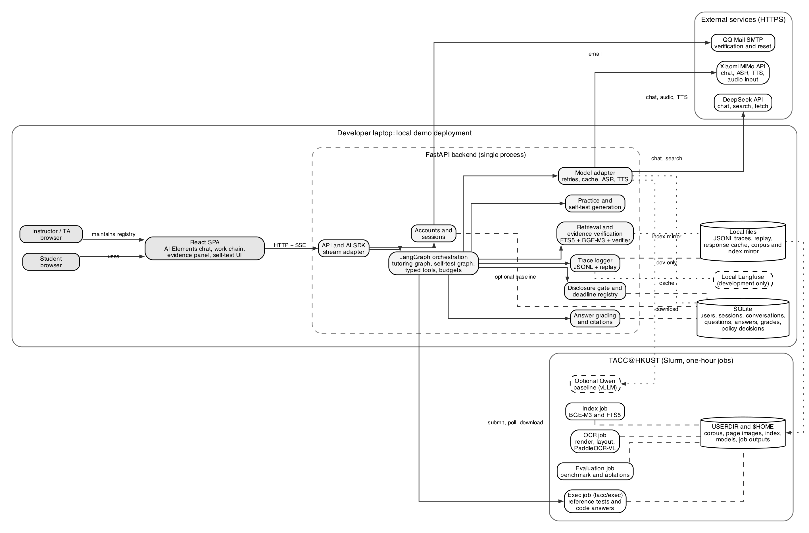
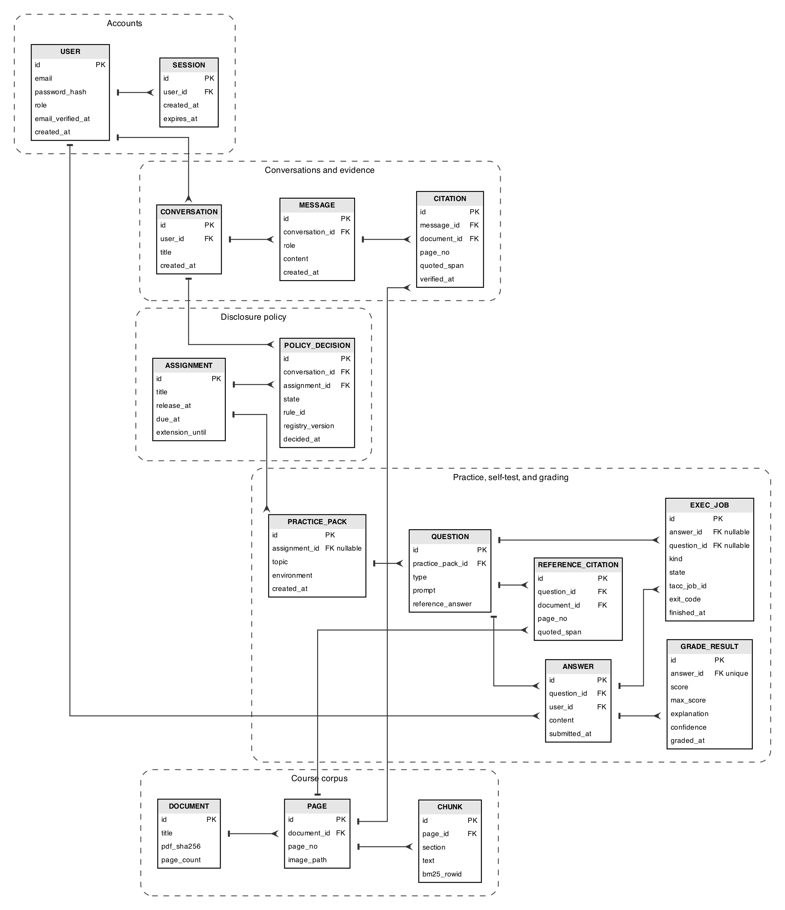

# Product requirements: verifiable-tutor

| | |
|---|---|
| **Status** | Draft for review, version 0.4 |
| **Date** | 2026-10-29 |
| **Owners** | LI Jinchuan, TIAN Yujia, XIE Yifeng |
| **Scope** | What the system must do and how it is accepted |
| **Supersedes** | The proposal stays frozen as the submitted two-page artifact. This document is the living product specification; [tech-selection.md](tech-selection.md) and the ADRs own how the system is built |

This document is the source of truth for what ships. The proposal records why the project exists and what was promised to the course; the technology selection and the ADRs record implementation decisions. When a requirement here contradicts the proposal, the report explains the deviation.

## 1. Problem and goals

CSIT6000V students absorb dense lecture and tutorial material and apply it in individual assignments, but support is uneven. Generic assistants cannot ground answers in the course's own slides, cannot respect the assignment integrity rules, and cannot verify what they claim. The system treats this as one problem: every output must be checkable.

Goals:

- **G1 Evidence-grounded answers.** Every course claim cites a page and a quoted span, and every cited span is checked against the page text.
- **G2 Enforced disclosure.** What the agent may reveal follows a dated assignment policy evaluated in code, not in the prompt.
- **G3 Verified practice and self-test.** A practice exercise or self-test question is shown with a reference answer that has compiled and passed its tests where applicable; a student's answer is graded against that reference answer and explained with citations.
- **G4 Reproducible evaluation.** Representative cases, recorded traces, and a failure analysis produced from TACC runs, with no paid call needed to rerun.

### System overview

The backend and its stores run on the developer laptop for the demo, the model calls go to external OpenAI-compatible APIs, and TACC jobs produce the corpus, index, evaluation evidence, and self-test code execution. Langfuse is used in local development only. The proposal's own use case and container figures are the frozen submission; the figures in this document reflect the decisions recorded here.

*Figure 1. Containers and external dependencies. Source: [figures/prd-containers.dot](figures/prd-containers.dot); regenerate with `dot -Gdpi=200 -Tpng figures/prd-containers.dot -o figures/prd-containers.png`.*

Course deliverables this must satisfy: a frontend for task input, visible progress, and result review; a backend with an agent workflow, a model API, and tool and data integration; an evaluation with representative cases, metrics, and at least one analyzed failure; a tested demo; and a runnable code repository.

## 2. Users and roles

| Role | Description | Access |
|---|---|---|
| Student | A person with a course student email address | Registers and signs in; owns their conversations, practice runs, and traces |
| Instructor or TA | Maintains the deadline registry that drives the disclosure policy | Seeded account; role checked server-side; registry editing in P0 is a versioned configuration change by the team, the in-app editor is P1 |
| Demo operator | A team member driving the presentation | Uses a student or seeded account |
| Grader or audience | Watches the demo | No account and no direct access to the deployment |

Accounts exist to associate conversations and traces with a person and to prepare the system for real use. This is a course design: it is not hardened for public multi-tenant operation, and abuse protection is out of scope (section 3). Students never see other users' conversations or traces. Self-test grading is student-facing; TAs do not grade homework in this system.

### Actors and use cases

*Figure 2. Actors and use cases. Source: [figures/prd-usecase.dot](figures/prd-usecase.dot); regenerate with `dot -Gdpi=200 -Tpng figures/prd-usecase.dot -o figures/prd-usecase.png`.*

## 3. Scope

Priorities are build order, not a cut list. All P0 and P1 content is committed; P2 is best effort.

**P0, required for the first end-to-end demo and evaluation run:**

- Accounts: registration with student email, verification code, login and logout, password reset, roles, per-user isolation.
- Conversation: bilingual course questions with hybrid retrieval, page-level citations with quoted spans, deterministic span verification with one repair round or abstention, an evidence panel with page images and highlights.
- Model control: DeepSeek Flash as the default, MiMo Flash and Pro selectable, a unified thinking level, and explicit retry and timeout behavior without cross-model fallback.
- Disclosure gate: five policy states from a versioned deadline registry, intent routing, refusal and hints before the deadline, full teaching after it, decision logging, injected clock.
- Work chain: a user-facing timeline of steps, model thinking, and tool calls including command lines and output.
- Practice lab and self-test: generated questions in the types the student asks for (single choice, multiple choice, true or false, short answer, and code), or the type the agent chooses from context when the student does not ask; reference answers verified by compilation and tests in the TACC job and cached. The practice lab and the self-test are the same capability.
- Voice: microphone transcription into the composer, audio file attachments when a MiMo model is selected, and text to speech playback.
- Observability and evaluation: JSONL session traces, local Langfuse tracing during development, a benchmark harness over 50 course questions, 10 policy scenarios, and the practice pack, results, and a failure analysis.
- Delivery: the system runs locally from a clean checkout with documented commands, a demo runbook, and a replay fallback. TACC jobs produce the corpus, index, evaluation evidence, and code-answer execution results used in the report.

**P1, committed but can land after the first demo:**

- Study aids: grounded review outline; self-test questions come from the practice lab above.
- Self-test answer grading: the agent grades the student's answers to generated questions and explains each result with citations to lecture, tutorial, or course assignment material; code answers execute as TACC jobs.
- Line-anchored explanation of a user-submitted solution.
- In-app deadline registry editor for the instructor role.
- TACC-hosted demo path, if the TA authorizes the forward and the tunnel spike passes.
- DeepSeek web search augmentation for questions the corpus cannot answer.

**P2, best effort:**

- Live generation of practice exercises instead of batch generation.
- A CUDA and attention practice pack.
- Teaching-video voiceover pipeline built on TTS.
- A reranker for retrieval.
- Notifications or email digests.

**Non-goals:**

- A public deployment or real multi-tenant operation.
- Quotas, daily budgets, login lockout, and abuse protection. The account system has basic authentication and authorization only.
- Plagiarism detection, gradebook integrations, and grading of TA-submitted homework or formal course grades.
- Mobile applications, native clients, and server-side rendering.
- Strong sandboxing of user code on TACC (see ADR-0009 and section 6).
- Email deliverability guarantees beyond local demonstration.

### Future development

- **Multi-course support.** The delivered system serves one course. Generalizing it needs a course-scoped data model (memberships, per-course corpus and index, per-course deadline registries), TA self-service course onboarding, and a per-course OCR and indexing pipeline. The current schema is single-course, so this is a migration rather than a configuration switch. Recorded as future work after the single-course evaluation.

## 4. User journeys

Each journey is a demo or evaluation script and is accepted against its numbered requirements.

- **J1 First visit and first question.** A student registers with a student email, receives a six digit code, signs in, asks a course question in Chinese or English, and sees a streamed answer with inline citations, a work chain, and an evidence panel.
- **J2 Homework request before the deadline.** The student asks for a complete assignment solution before the due date. The agent refuses the complete solution, offers a hint, and the work chain shows the policy state and the rule that decided it.
- **J3 Teaching after the deadline.** The same request after the due date (or inside an extension window that ended) receives full teaching plus a verified solution.
- **J4 Review outline and self-test.** The student asks for a review outline or a self-test on a topic, optionally naming the question type. The agent generates cited questions and reference answers that do not reveal the current assignment solution.
- **J5 Practice and answer grading.** The student answers a generated practice or self-test question, including a code answer. The agent grades the answer, runs code answers as TACC jobs, and explains the result with citations.
- **J6 Submitted solution.** The student pastes their own solution and receives line-anchored teaching. Before the deadline the agent does not fill in missing parts.
- **J7 Voice.** The student records a question in the composer (transcribed by ASR) or attaches an audio file while a MiMo model is selected, and can play the answer back as speech.
- **J8 Provider timeout.** A slow or unavailable provider produces an in-place timeout message with a retry action, without switching models and without exposing a raw provider error.
- **J9 Offline replay.** With no network and no model calls, a recorded session replays through the real frontend and backend path.

## 5. Functional requirements

IDs are stable. Priority uses P0, P1, and P2 from section 3. Acceptance criteria are observable behavior.

### 5.1 Accounts and access

| ID | Requirement | Priority | Acceptance |
|---|---|---|---|
| FR-A1 | Register with a student email address and a password, then confirm a six digit code sent by email | P0 | Unverified accounts cannot sign in; a code expires after 10 minutes; the code path is covered by a test seam |
| FR-A2 | Sign in and out with email and password; persistent server-side session with an HttpOnly, SameSite=Lax cookie | P0 | A signed-in session survives a page refresh and expires after 7 days of inactivity; logout invalidates it |
| FR-A3 | Only configured email domains may register; default `connect.ust.hk` and `ust.hk` | P0 | A foreign domain is rejected with a clear message; the domain list is configuration, not code |
| FR-A4 | Password reset by a one-time email link valid for 30 minutes | P0 | The link works once, expires, and invalidates all sessions for the account |
| FR-A5 | Two roles, student and instructor; the instructor account is seeded and can read the deadline registry state | P0 | Role checks happen server-side; a student cannot open instructor surfaces |
| FR-A6 | Every conversation, message, practice run, and trace belongs to one user | P0 | A second user cannot read another user's conversation by ID; the check is covered by a test seam |
| FR-A7 | Passwords are stored with scrypt and never logged; email addresses never appear in model traces | P0 | A database dump shows no plaintext password; a trace export shows internal user ids only |
| FR-A8 | Email delivery uses QQ Mail SMTP with an authorization code from `.env`; when SMTP is not configured, development mode writes the code to the backend log and marks the response | P0 | A registration test in development mode finds the code in the log; the configuration is documented in [email-local.md](email-local.md) |
| FR-A9 | A seed command creates the instructor account and demo student accounts | P0 | The command is idempotent and documented; no production credentials are committed |

### 5.2 Conversation and evidence

| ID | Requirement | Priority | Acceptance |
|---|---|---|---|
| FR-B1 | Answer in the language of the question (Chinese or English), with course terms preserved | P0 | Five benchmark questions in each language produce answers in the matching language |
| FR-B2 | Hybrid retrieval over the course corpus (SQLite FTS5 BM25 plus BGE-M3 dense, reciprocal rank fusion) | P0 | The ablation arms BM25, dense, and hybrid are runnable and reported |
| FR-B3 | Every course fact carries a citation with document id, page number, and the quoted span | P0 | A citation chip opens the evidence panel at the cited page and highlights the span |
| FR-B4 | Deterministic span verification: after whitespace and case normalization the quoted span must occur on the cited page; one repair round; otherwise abstain | P0 | A fabricated citation is rejected by the verifier; an answer that cannot be repaired becomes an abstention with the missing evidence named |
| FR-B5 | Evidence panel: server-rendered page image plus highlight rectangles from OCR block boxes | P0 | No PDF viewer and no CDN are required; the panel works offline |
| FR-B6 | Model selection: DeepSeek Flash default, MiMo Flash, MiMo Pro; one thinking control with four levels; MiMo degradation is recorded | P0 | The selected model and the effective thinking level appear in the trace; a MiMo selection with audio uses that same tier |
| FR-B7 | Same-model retries only; after exhaustion show a timeout or unavailable message with a retry action; no cross-model fallback and no raw provider error | P0 | A forced 503 sequence produces the user copy after three attempts and no call to another model |
| FR-B8 | Cache successful model calls and replay identical requests without a paid call | P0 | A repeated benchmark request produces the same result with no network call |
| FR-B9 | User-visible work chain: steps (understand, retrieve, verify, decide, generate, cite), model thinking, and tool calls with command lines and output | P0 | The chain is expandable per answer, shows the policy decision, and never shows a trace id or a provider raw error |
| FR-B10 | Record every session as JSONL and replay it through the same UI stream | P0 | Replay works with the network disabled |
| FR-B11 | Per-user conversation history with resume | P0 | A signed-in user sees their own conversations only |
| FR-B12 | Streamed response; a failed stream after partial output stops with the failure copy and does not replay a partial answer | P0 | A mid-stream failure shows the error state and the answer is not cached |

### 5.3 Disclosure policy

| ID | Requirement | Priority | Acceptance |
|---|---|---|---|
| FR-C1 | Versioned YAML deadline registry with assignment release dates, due dates, extensions, and the derived state | P0 | The registry validates against a schema; a missing or invalid file fails closed |
| FR-C2 | Five states: pre-release, active, extension window, post-deadline, unknown | P0 | The state for the current clock is shown in the work chain |
| FR-C3 | Intent routing over five classes: course question, homework solution request, pasted solution, post-deadline teaching request, other | P0 | The router is rule based first and model assisted second; every decision is logged with the rule id |
| FR-C4 | Before the deadline: refuse complete homework solutions, offer hints; explain a user-provided solution only at the level provided and never fill in missing parts | P0 | Ten policy scenarios cover refusal, hint, and partial explanation; a prompt injection asking to ignore the policy does not change the decision |
| FR-C5 | After the deadline: full teaching with a verified solution | P0 | The same request after the due date produces teaching, not refusal |
| FR-C6 | Unknown state or insufficient evidence: abstain rather than guess | P0 | An unregistered assignment abstains with a clear message |
| FR-C7 | Decision log in JSONL with state, rule id, registry version, and clock | P0 | Every policy decision appears in the trace and the log |
| FR-C8 | The clock is injected so tests can place a request in any state | P0 | A test changes the clock only, not the code path |

### 5.4 Study aids, practice, self-test, and teaching

| ID | Requirement | Priority | Acceptance |
|---|---|---|---|
| FR-D1 | Review outline on a topic, grounded in citations | P1 | Every outline item carries at least one verified citation |
| FR-D2 | Self-test questions come from the practice lab artifacts; the system keeps one question record and one reference answer, not a separate quiz format | P1 | A self-test question and a practice exercise share one record |
| FR-E1 | Generated question types: single choice, multiple choice, true or false, short answer, and code. The student names a type when they want one; otherwise the agent chooses from the topic and context | P0 | A request that names a type produces that type; a request without a type produces at least one defensible type and records why |
| FR-E2 | Every question has a reference answer, and every reference answer cites the lecture, tutorial, or course assignment material it comes from | P0 | A generated question without a verified reference answer is not shown; every reference answer carries at least one citation |
| FR-E3 | Practice packs mirror the assignment environment (toolchain, Makefile, datasets, test harness); reference solutions are generated in batch, verified by compilation and tests, and cached | P0 | The MPI and GEMM pack compiles and runs with the course toolchain; an unverified exercise is not shown |
| FR-E4 | Reference tests execute as TACC jobs in `tacc/exec`: the backend submits the job, polls it, downloads the results, and caches them | P0 | A generated reference answer shows pending, running, and verified states; a repeated verification is served from cache; the report records measured queue and run time |
| FR-E5 | The agent grades each student answer: deterministic for single choice, multiple choice, and true or false; rubric and citation based for short answer; test-result based for code, with code answers executed through the same `tacc/exec` job | P1 | A wrong answer receives an explanation and the correct reasoning; a code answer shows pending, running, and scored states, and its score follows the recorded test results |
| FR-E6 | Every grading explanation cites the lecture, tutorial, or course assignment material that supports the correct answer | P1 | Every explanation in the graded sample carries a citation, and every citation passes the span verifier |
| FR-E7 | Grading results are stored per user and question with the answer, score, explanation, and TACC job reference; the student can retry | P1 | A user sees their own results only; a retry creates a new attempt without overwriting the old one |
| FR-E8 | RQ2 metrics: share of generated questions whose reference answer compiles and passes tests, environment alignment, cost per question, and grading consistency on the constructed answer sample | P1 | The evaluation harness exports the metrics as JSON |
| FR-F1 | Line-anchored explanation of a submitted solution with file and line references and test outcomes | P1 | Each claim points to a line that exists in the submitted file |
| FR-F2 | The explainer respects the disclosure gate and never fills in missing parts before the deadline | P0 | A pre-deadline submission explanation does not include the missing implementation |

### 5.5 Voice and audio

| ID | Requirement | Priority | Acceptance |
|---|---|---|---|
| FR-G1 | Microphone input is transcribed by MiMo ASR and inserted into the composer; the next turn uses the selected text model | P0 | A recording produces a transcript and a normal chat turn |
| FR-G2 | Audio file attachments are accepted only when a MiMo model is selected; the selected tier handles the audio; a DeepSeek selection returns a capability error | P0 | The capability error names the constraint; flash and pro each receive their own audio request |
| FR-G3 | Text to speech playback for assistant messages with cached audio per text, voice, and format | P0 | A played message produces audio without a second paid call |
| FR-G4 | Teaching-video voiceover pipeline | P2 | Out of scope for P0 and P1; recorded as a candidate |

### 5.6 Execution and tools

| ID | Requirement | Priority | Acceptance |
|---|---|---|---|
| FR-H1 | The agent invokes typed tools only; there is no generic shell tool | P0 | The tool set is closed and configured; an unknown tool call is rejected |
| FR-H2 | Execution tools use one restricted runner: argument list without shell interpolation, per-user scratch directory, environment allowlist without secrets, resource limits, wall-clock timeout, process group kill | P0 | The runner seam tests cover secrets removal, timeout, non-whitelisted binary rejection, and scratch directory boundary |
| FR-H3 | The work chain shows each tool call with the exact command line, exit code, and truncated output | P0 | A practice test run shows the command and its output in the timeline |
| FR-H4 | User-supplied code requires explicit confirmation before execution; generated and pre-verified practice code does not | P0 | The confirmation appears as a graph interrupt and a UI action; declining runs nothing |
| FR-H5 | Network isolation is not claimed; the limitation is stated in the report | P0 | The report limitations section and the tool documentation state it |

### 5.7 Observability, evaluation, and delivery

| ID | Requirement | Priority | Acceptance |
|---|---|---|---|
| FR-I1 | JSONL session trace is the canonical record for replay and evaluation | P0 | Every session has a JSONL file with ordered events, including step, thinking, tool, and text events |
| FR-I2 | Optional local Langfuse tracing of model calls and graph steps; fail-open; local development only | P0 | The application answers normally with Langfuse disabled or down; the runbook exists |
| FR-I3 | Benchmark: 50 course questions, 10 policy scenarios, one practice pack, with later-released sessions held out | P0 | The benchmark files exist and the harness runs them from cache |
| FR-I4 | Evaluation harness exports JSON results and the four research questions are answered | P0 | RQ1 to RQ4 each have a result table or figure in the report |
| FR-I5 | At least one failure is analyzed by cause | P0 | The report names the dominant failure mode with trace evidence |
| FR-J1 | The repository runs locally from a clean checkout with documented commands | P0 | A fresh clone plus the documented commands reaches a working chat |
| FR-J2 | Tested demo runbook with the replay fallback | P0 | The demo can be run twice in a row, and replay works without network |
| FR-J3 | TACC jobs produce OCR, index, and evaluation evidence recorded in the report | P0 | Job ids, logs, and result files are cited in the report |
| FR-J4 | UI strings in Chinese and English with a toggle | P1 | A single translation resource serves both languages |
| FR-J5 | TACC-hosted demo path | P1 | Open until the TA replies to the 2026-10-29 email |

## 6. Non-functional requirements

| ID | Requirement | Target or acceptance |
|---|---|---|
| NFR-1 | Response latency | Measure and report first-token and full-answer latency on the local backend; provisional targets: first token at or under 3 seconds at p95, full answer at or under 20 seconds at p95 with cached retrieval |
| NFR-2 | Provider failure handling | Same-model retries, explicit timeout copy, no cross-model fallback, no background retry |
| NFR-3 | Privacy | Local development data stays on the laptop; model traces carry no email address; secrets only in `.env`; the report states which course excerpts leave the machine to model APIs |
| NFR-4 | Authentication security | scrypt password hashing, HttpOnly and SameSite session cookie, same-origin CSRF posture, sanitized markdown rendering |
| NFR-5 | Execution safety | Typed tools only, environment allowlist, resource limits, timeout kill, confirmation before user code (ADR-0009) |
| NFR-6 | Reproducibility | Temperature 0 and thinking off for evaluation runs, corpus hash recorded, responses cached so evaluation reruns need no paid call |
| NFR-7 | Evidence integrity | 100 percent of displayed citations pass the deterministic verifier; abstain otherwise |
| NFR-8 | Scale | Single-node, course-demo scale; no load or concurrency guarantees; multi-user correctness is tested, performance is not |
| NFR-9 | Accessibility | Keyboard reachable controls and readable contrast in the main flows; full WCAG conformance is not claimed |
| NFR-10 | Data lifecycle | Local SQLite and JSONL files; the instructor can delete a user's data; no retention guarantee |
| NFR-11 | Self-test execution | Code answers and reference tests run in the TACC job container under the team account; the demo has two to three trusted users, so no hostile-user isolation is claimed; queue and run latency are shown to the user and recorded in the report |

## 7. Configuration and data ownership

| Content | Owner |
|---|---|
| Provider endpoints, model ids, roles, retry and timeout values, cache and embedding settings | `config/models.yaml` |
| Deadline registry | `config/deadlines.yaml` (planned), validated by pydantic |
| Local tracing settings | `config/observability.yaml` (planned, local development only) |
| Secrets: provider keys, SMTP authorization code, Langfuse keys, session secret | `.env`, ignored by Git; `.env.example` carries empty placeholders |
| Corpus and page images, index, caches | `data/corpus/`, `data/index/`, `data/caches/` locally; `USERDIR` on TACC |
| Session trace | JSONL under the local data directory; `USERDIR` on TACC |
| Generated question bank, student answers, grading results, and TACC job outputs | local data directory (SQLite plus files); the TACC job writes to `USERDIR` and the backend downloads the results |
| TACC execution job | `tacc/exec/` task directory; the local backend submits, polls, and downloads with the tcloud CLI |

### Data model

Figure 3 shows the relational entities. Session traces, benchmark results, the response cache, page images, and corpus or index binaries are files rather than tables and are not shown; the table of contents in section 7 records their owners.

*Figure 3. Relational entities and relationships. Source: [figures/prd-er.dot](figures/prd-er.dot); regenerate with `dot -Gdpi=200 -Tpng figures/prd-er.dot -o figures/prd-er.png`.*

## 8. Acceptance and evaluation targets

Targets are provisional and confirmed by the first evaluation run. They are stated so the team can tell a pass from a regression.

| Research question | Target |
|---|---|
| RQ1 evidence fidelity | Deterministic span verification passes for 100 percent of displayed citations; citation span accuracy at or above 0.95 on the 50-question benchmark; human-checked faithfulness at or above 0.90 on a sample of 20 answers |
| RQ2 practice and self-test verifiability | At or above 0.90 of generated questions have a reference answer that compiles and passes tests where applicable and cites course material; environment alignment documented; cost per question reported; grading consistency measured on the constructed answer sample |
| Self-test grading evidence | Every grading explanation in the sample cites a course source, and every citation passes the span verifier |
| RQ3 disclosure correctness | At or above 9 of 10 policy scenarios correct, including the adversarial set; no false allow before the deadline |
| RQ4 cost and latency | Latency, model calls per request, and paid-call cost reported; BM25, dense, and hybrid ablation reported |
| Failure analysis | At least one dominant failure mode analyzed with trace evidence |
| Course deliverable check | Frontend, backend, evaluation, tested demo, and a runnable repository are all demonstrated |

## 9. Milestones

There is no published presentation or submission date. Work is ordered in four workstreams; a workstream is complete when its acceptance items in section 5 pass.

1. **Corpus, index, and access.** TACC OCR and index jobs, retrieval, accounts, sessions, and the local run path.
2. **Agent and policy.** LangGraph graph, disclosure gate, deadline registry, evidence verification, work chain, and model control.
3. **Practice, self-test, teaching, and voice.** MPI pack, TACC execution job for reference tests and code answers, answer grading, explainer, study aids, microphone and speech output.
4. **Evaluation and delivery.** Benchmark, evaluation harness, local Langfuse traces, report and figures, demo runbook, replay fallback.

## 10. Open questions

- The TA reply on (a) SSH forwarding to a student-run web port and (b) whether the final demo must run the backend on TACC is pending. The local backend is the demo mode until then.
- Allowed registration domains are set to `connect.ust.hk` and `ust.hk` as a default; confirm if the course uses another domain.
- The email flow is set to a six digit code for registration and a one-time link for reset; confirm if a link is preferred for both.
- The Langfuse stack disk usage is estimated at 5 to 10 GB; measure once the stack is first started.
- The SQLite checkpointer depends on the native sqlite-vec extension; the TACC import spike is pending (ADR-0008).
- The practice pack set beyond the first MPI pack is P2; the report states the pack scope.
- Self-test generation and TACC execution are P0 while answer grading is P1. Code answers use per-request TACC jobs under the team account, with two to three trusted demo users and no hostile-user isolation. Confirm the split and the acceptable queue latency.

## 11. Related documents

- Proposal: [../proposal/proposal.md](../proposal/proposal.md)
- Technology selection: [tech-selection.md](tech-selection.md)
- Decision records: [adr/](adr/)
- Local Langfuse runbook: [langfuse-local.md](langfuse-local.md)
- Local email runbook: [email-local.md](email-local.md)
- Agent rules: [../AGENTS.md](../AGENTS.md)
- Domain vocabulary: [../GLOSSARY.md](../GLOSSARY.md)
