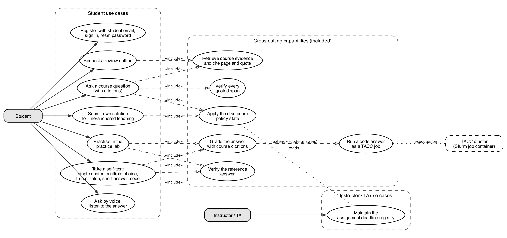
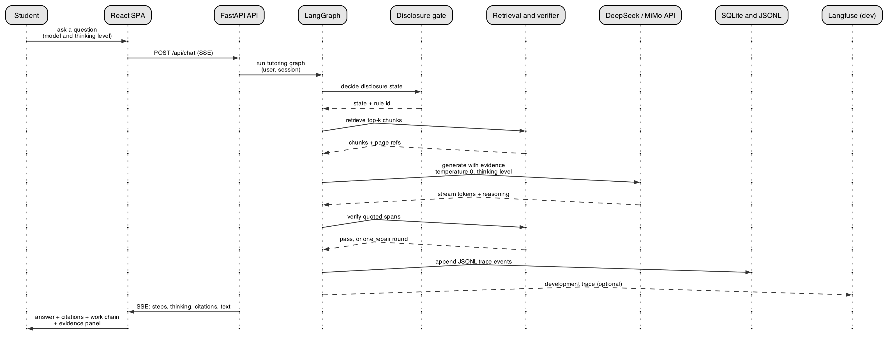
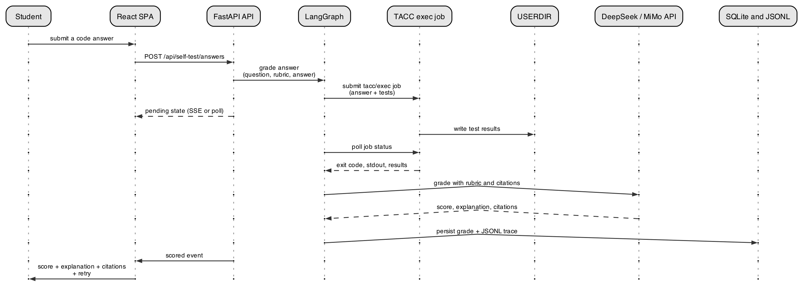
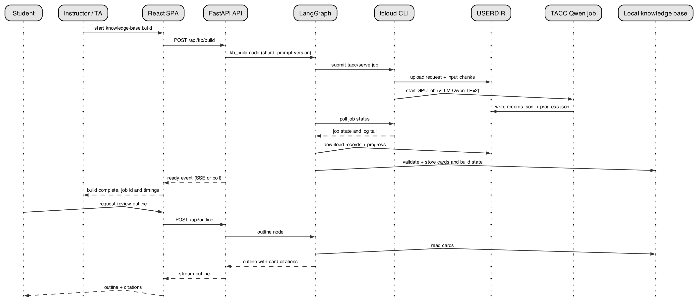

# Product requirements: verifiable-tutor

| | |
|---|---|
| **Status** | Draft for review, version 0.10 |
| **Date** | 2026-11-01 |
| **Owners** | LI Jinchuan, TIAN Yujia, XIE Yifeng |
| **Scope** | What the system must do and how it is accepted |
| **Supersedes** | Proposal v1 (submitted 2026-10-27) remains the submitted artifact; proposal v2 (dated 2026-10-30) is a previous draft; proposal v3 (dated 2026-11-01) is the current statement of the plan and aligns with this document. This document is the living product specification; [tech-selection.md](tech-selection.md) and the ADRs own how the system is built |

This document is the source of truth for what ships. Proposal v1 records why the project exists and what was promised to the course; proposal v3 records the required TACC model-serving backend and the knowledge base. When a requirement here contradicts proposal v1, the report explains the change; proposal v3 aligns with this document. The technology selection and the ADRs record implementation decisions.

Version 0.10 records the 2026-11-01 staff requirement that TACC be a required model-serving backend, adds the Qwen knowledge-base pipeline, and updates proposal references from v2 to v3.

## 1. Problem and goals

CSIT6000V students absorb dense lecture and tutorial material and apply it in individual assignments, but support is uneven. Generic assistants cannot ground answers in the course's own slides, cannot respect the assignment integrity rules, and cannot verify what they claim. The system treats this as one problem: every output must be checkable.

Goals:

- **G1 Evidence-grounded answers.** Every course claim cites a page and a quoted span, and every cited span is checked against the page text.
- **G2 Enforced disclosure.** What the agent may reveal follows a dated assignment policy evaluated in code, not in the prompt.
- **G3 Verified practice and self-test.** A practice exercise or self-test question is shown with a reference answer that has compiled and passed its tests where applicable; a student's answer is graded against that reference answer and explained with citations.
- **G4 Reproducible evaluation.** Representative cases, recorded traces, and a failure analysis produced from TACC runs, with no paid call needed to rerun.

**Project direction.** The course project brief lists two recommended exploration directions: task learning and adaptation, and system efficiency. This project takes the task-oriented direction: it targets tutoring-task performance for one course and quantifies that performance against baselines, namely an external chatbot for the self-test loop and a prompt-only policy for disclosure. Efficiency metrics (latency, model calls, cost) are reported as RQ4 and are not the optimization target (course project brief and lecture 0 slides, in the course workspace outside this repository; [proposal v3](../proposal/proposal_v3.md#4-evaluation-plan)).

### System overview

The backend and its stores run on the developer laptop. Interactive model calls go to external OpenAI-compatible APIs, and TACC is a required model-serving backend: submitted GPU jobs run the BGE-M3 embedding index and the Qwen knowledge-base enrichment, and their outputs are downloaded into the local mirror and knowledge base. TACC access is job submission only, with no SSH forwarding and no inbound service ([ADR-0011](adr/0011-tacc-as-required-model-serving-backend.md), [tacc-notes.md](tacc-notes.md#staff-clarification-2026-11-01)). Langfuse is used in local development only. Proposal v3 redraws the container figure for the delivered topology, and the figures in this document follow the decisions recorded here.

*Figure 1. Containers and external dependencies. Source: [figures/prd-containers.dot](figures/prd-containers.dot); regenerate with `dot -Gdpi=200 -Tpng figures/prd-containers.dot -o figures/prd-containers.png`.*

Course deliverables this must satisfy: a frontend for task input, visible progress, and result review; a backend with an agent workflow, a model API, and tool and data integration; an evaluation with representative cases, metrics, and at least one analyzed failure; a tested demo; and a runnable code repository.

## 2. Users and roles

| Role | Description | Access |
|---|---|---|
| Student | A person with a course student email address | Registers and signs in; owns their conversations, practice runs, and traces; browses the course knowledge base |
| Instructor or TA | Maintains the deadline registry that drives the disclosure policy and triggers knowledge-base builds | Seeded account; role checked server-side; registry editing in P0 is a versioned configuration change by the team, the in-app editor is P1 |
| Demo operator | A team member driving the presentation | Uses a student or seeded account |
| Grader or audience | Watches the demo | No account and no direct access to the deployment |

Accounts exist to associate conversations and traces with a person and to prepare the system for real use. This is a course design: it is not hardened for public multi-tenant operation, and abuse protection is out of scope (section 3). Students never see other users' conversations or traces. Self-test grading is student-facing; TAs do not grade homework in this system.

### Actors and use cases

*Figure 2. Actors and use cases, including the knowledge base. Source: [figures/prd-usecase.dot](figures/prd-usecase.dot); regenerate with `dot -Gdpi=200 -Tpng figures/prd-usecase.dot -o figures/prd-usecase.png`.*

## 3. Scope

Priorities are build order, not a cut list. All P0 and P1 content is committed; P2 is best effort.

**P0, required for the first end-to-end demo and evaluation run:**

- Accounts: registration with student email, verification code, login and logout, password reset, roles, per-user isolation.
- Conversation: bilingual course questions with hybrid retrieval, page-level citations with quoted spans, deterministic span verification with one repair round or abstention, an evidence panel with page images and highlights.
- Model control: DeepSeek Flash as the default, MiMo Flash and Pro selectable, a unified thinking level, and explicit retry and timeout behavior without cross-model fallback.
- Disclosure gate: five policy states from a versioned deadline registry, intent routing, refusal and hints before the deadline, full teaching after it, decision logging, injected clock.
- Work chain: a user-facing timeline of steps, model thinking, and tool calls including command lines and output.
- Practice lab and self-test: generated questions in the types the student asks for (single choice, multiple choice, true or false, short answer, and code), or the type the agent chooses from context when the student does not ask; reference answers verified by compilation and tests in the TACC job and cached. The practice lab and the self-test are the same capability.
- Knowledge base: a required Qwen text-processing job on TACC builds cited course knowledge cards (summary, key concepts, study questions) that are stored locally, browsable, and used by review outlines and self-tests (FR-K1 to FR-K4).
- Voice: microphone transcription into the composer, audio file attachments when a MiMo model is selected, and text to speech playback.
- Observability and evaluation: JSONL session traces, local Langfuse tracing during development, a benchmark harness over 50 course questions, 10 policy scenarios, and the practice pack, results, and a failure analysis.
- Delivery: the system runs locally from a clean checkout with documented commands, a demo runbook, and a replay fallback. TACC jobs produce the corpus, index, evaluation evidence, code-answer execution results, and the knowledge base used in the demo and report.

**P1, committed but can land after the first demo:**

- Study aids: grounded review outline; self-test questions come from the practice lab above.
- Self-test answer grading: the agent grades the student's answers to generated questions and explains each result with citations to lecture, tutorial, or course assignment material; code answers execute as TACC jobs.
- Line-anchored explanation of a user-submitted solution.
- In-app deadline registry editor for the instructor role.
- DeepSeek web search augmentation for questions the corpus cannot answer.

**P2, best effort:**

- Live generation of practice exercises instead of batch generation.
- A CUDA and attention practice pack.
- Teaching-video voiceover pipeline built on TTS.
- A reranker for retrieval.
- Notifications or email digests.

**Non-goals:**

- A public deployment or real multi-tenant operation.
- Hosting the backend, the UI, or any long-running service on TACC. TACC model serving runs inside submitted jobs and is reached only through job submission; no port forwarding or inbound service is used ([ADR-0011](adr/0011-tacc-as-required-model-serving-backend.md)).
- Quotas, daily budgets, login lockout, and abuse protection. The account system has basic authentication and authorization only.
- Plagiarism detection, gradebook integrations, and grading of TA-submitted homework or formal course grades.
- Mobile applications, native clients, and server-side rendering.
- Strong sandboxing of user code on TACC (see ADR-0009 and section 6).
- Email deliverability guarantees beyond local demonstration.

### Future development

- **Multi-course support.** The delivered system serves one course. Generalizing it needs a course-scoped data model (memberships, per-course corpus and index, per-course deadline registries), TA self-service course onboarding, and a per-course OCR and indexing pipeline. The current schema is single-course, so this is a migration rather than a configuration switch. Recorded as future work after the single-course evaluation.

## 4. User journeys

Each journey is a demo or evaluation script and is accepted against its numbered requirements.

- **J1 First visit and first question.** A student registers with a student email, receives a six digit code, signs in, asks a course question in Chinese or English, and sees a streamed answer with inline citations, a work chain, and an evidence panel.
- **J2 Homework request before the deadline.** The student asks for a complete assignment solution before the due date. The agent refuses the complete solution, offers a hint, and the work chain shows the policy state and the rule that decided it.
- **J3 Teaching after the deadline.** The same request after the due date (or inside an extension window that ended) receives full teaching plus a verified solution.
- **J4 Review outline and self-test.** The student asks for a review outline or a self-test on a topic, optionally naming the question type. The agent generates cited questions and reference answers that do not reveal the current assignment solution.
- **J5 Practice and answer grading.** The student answers a generated practice or self-test question, including a code answer. The agent grades the answer, runs code answers as TACC jobs, and explains the result with citations.
- **J6 Submitted solution.** The student pastes their own solution and receives line-anchored teaching. Before the deadline the agent does not fill in missing parts.
- **J7 Voice.** The student records a question in the composer (transcribed by ASR) or attaches an audio file while a MiMo model is selected, and can play the answer back as speech.
- **J8 Provider timeout.** A slow or unavailable provider produces an in-place timeout message with a retry action, without switching models and without exposing a raw provider error.
- **J9 Offline replay.** With no network and no model calls, a recorded session replays through the real frontend and backend path.
- **J10 Knowledge base.** An instructor or TA starts a knowledge-base build from the UI. The local backend submits one TACC Qwen job for a document shard, shows queued and running states, downloads and validates the JSONL records when the job finishes, and stores them locally. A student browses the cards and asks for a review outline that cites them; the work chain shows the job id, timings, and build status.

### Sequence examples

Figure 3 traces one question: the disclosure gate runs before retrieval, quoted spans are verified before the answer is shown, and the same events feed the work chain and the JSONL trace. Figure 4 traces a code self-test answer: the backend submits a `tacc/exec` job, polls it, and grades from the recorded test results. Reference answers are verified through the same exec job at generation time, which the second diagram omits for space. Figure 5 traces a knowledge-base build: the UI starts the build, the backend submits one TACC Qwen job, polls it, downloads and validates the records, stores them locally, and the student uses them in a review outline.

*Figure 3. Answer a course question. Source: [figures/prd-sequence-question.dot](figures/prd-sequence-question.dot); regenerate with `dot -Gdpi=200 -Tpng figures/prd-sequence-question.dot -o figures/prd-sequence-question.png`.*

*Figure 4. Grade a self-test answer with a TACC job. Source: [figures/prd-sequence-grading.dot](figures/prd-sequence-grading.dot); regenerate with `dot -Gdpi=200 -Tpng figures/prd-sequence-grading.dot -o figures/prd-sequence-grading.png`.*

*Figure 5. Build the knowledge base with a TACC Qwen job. Source: [figures/prd-sequence-kb-build.dot](figures/prd-sequence-kb-build.dot); regenerate with `dot -Gdpi=200 -Tpng figures/prd-sequence-kb-build.dot -o figures/prd-sequence-kb-build.png`.*

## 5. Functional requirements

IDs are stable. Priority uses P0, P1, and P2 from section 3. Acceptance criteria are observable behavior.

### 5.1 Accounts and access

| ID | Requirement | Priority | Acceptance |
|---|---|---|---|
| FR-A1 | Register with a student email address and a password, then confirm a six digit code sent by email | P0 | Unverified accounts cannot sign in; a code expires after 10 minutes; the code path is covered by a test seam |
| FR-A2 | Sign in and out with email and password; persistent server-side session with an HttpOnly, SameSite=Lax cookie | P0 | A signed-in session survives a page refresh and expires after 7 days of inactivity; logout invalidates it |
| FR-A3 | Only configured email domains may register; default `connect.ust.hk` and `ust.hk` | P0 | A foreign domain is rejected with a clear message; the domain list is configuration, not code |
| FR-A4 | Password reset by a one-time email link valid for 30 minutes | P0 | The link works once, expires, and invalidates all sessions for the account |
| FR-A5 | Two roles, student and instructor; the instructor account is seeded and can read the deadline registry state | P0 | Role checks happen server-side; a student cannot open instructor surfaces |
| FR-A6 | Every conversation, message, practice run, and trace belongs to one user | P0 | A second user cannot read another user's conversation by ID; the check is covered by a test seam |
| FR-A7 | Passwords are stored with scrypt and never logged; email addresses never appear in model traces | P0 | A database dump shows no plaintext password; a trace export shows internal user ids only |
| FR-A8 | Email delivery uses QQ Mail SMTP with an authorization code from `.env`; when SMTP is not configured, development mode writes the code to the backend log and marks the response | P0 | A registration test in development mode finds the code in the log; the configuration is documented in [email-local.md](email-local.md) |
| FR-A9 | A seed command creates the instructor account and demo student accounts | P0 | The command is idempotent and documented; no production credentials are committed |

### 5.2 Conversation and evidence

| ID | Requirement | Priority | Acceptance |
|---|---|---|---|
| FR-B1 | Answer in the language of the question (Chinese or English), with course terms preserved | P0 | Five benchmark questions in each language produce answers in the matching language |
| FR-B2 | Hybrid retrieval over the course corpus (SQLite FTS5 BM25 plus BGE-M3 dense, reciprocal rank fusion) | P0 | The ablation arms BM25, dense, and hybrid are runnable and reported |
| FR-B3 | Every course fact carries a citation with document id, page number, and the quoted span | P0 | A citation chip opens the evidence panel at the cited page and highlights the span |
| FR-B4 | Deterministic span verification: after whitespace and case normalization the quoted span must occur on the cited page; one repair round; otherwise abstain | P0 | A fabricated citation is rejected by the verifier; an answer that cannot be repaired becomes an abstention with the missing evidence named |
| FR-B5 | Evidence panel: server-rendered page image plus highlight rectangles from OCR block boxes | P0 | No PDF viewer and no CDN are required; the panel works offline |
| FR-B6 | Model selection: DeepSeek Flash default, MiMo Flash, MiMo Pro; one thinking control with four levels; MiMo degradation is recorded. Qwen on TACC is an offline knowledge-base backend, not a selectable chat model. | P0 | The selected model and the effective thinking level appear in the trace; a MiMo selection with audio uses that same tier |
| FR-B7 | Same-model retries only; after exhaustion show a timeout or unavailable message with a retry action; no cross-model fallback and no raw provider error | P0 | A forced 503 sequence produces the user copy after three attempts and no call to another model |
| FR-B8 | Cache successful model calls and replay identical requests without a paid call | P0 | A repeated benchmark request produces the same result with no network call |
| FR-B9 | User-visible work chain: steps (understand, retrieve, verify, decide, generate, cite), model thinking, and tool calls with command lines and output | P0 | The chain is expandable per answer, shows the policy decision, and never shows a trace id or a provider raw error |
| FR-B10 | Record every session as JSONL and replay it through the same UI stream | P0 | Replay works with the network disabled |
| FR-B11 | Per-user conversation history with resume | P0 | A signed-in user sees their own conversations only |
| FR-B12 | Streamed response; a failed stream after partial output stops with the failure copy and does not replay a partial answer | P0 | A mid-stream failure shows the error state and the answer is not cached |

### 5.3 Disclosure policy

| ID | Requirement | Priority | Acceptance |
|---|---|---|---|
| FR-C1 | Versioned YAML deadline registry with assignment release dates, due dates, extensions, and the derived state | P0 | The registry validates against a schema; a missing or invalid file fails closed |
| FR-C2 | Five states: pre-release, active, extension window, post-deadline, unknown | P0 | The state for the current clock is shown in the work chain |
| FR-C3 | Intent routing over five classes: course question, homework solution request, pasted solution, post-deadline teaching request, other | P0 | The router is rule based first and model assisted second; every decision is logged with the rule id |
| FR-C4 | Before the deadline: refuse complete homework solutions, offer hints; explain a user-provided solution only at the level provided and never fill in missing parts | P0 | Ten policy scenarios cover refusal, hint, and partial explanation; a prompt injection asking to ignore the policy does not change the decision |
| FR-C5 | After the deadline: full teaching with a verified solution | P0 | The same request after the due date produces teaching, not refusal |
| FR-C6 | Unknown state or insufficient evidence: abstain rather than guess | P0 | An unregistered assignment abstains with a clear message |
| FR-C7 | Decision log in JSONL with state, rule id, registry version, and clock | P0 | Every policy decision appears in the trace and the log |
| FR-C8 | The clock is injected so tests can place a request in any state | P0 | A test changes the clock only, not the code path |

### 5.4 Study aids, practice, self-test, and teaching

| ID | Requirement | Priority | Acceptance |
|---|---|---|---|
| FR-D1 | Review outline on a topic, grounded in citations | P1 | Every outline item carries at least one verified citation |
| FR-D2 | Self-test questions come from the practice lab artifacts; the system keeps one question record and one reference answer, not a separate quiz format | P1 | A self-test question and a practice exercise share one record |
| FR-E1 | Generated question types: single choice, multiple choice, true or false, short answer, and code. The student names a type when they want one; otherwise the agent chooses from the topic and context | P0 | A request that names a type produces that type; a request without a type produces at least one defensible type and records why |
| FR-E2 | Every question has a reference answer, and every reference answer cites the lecture, tutorial, or course assignment material it comes from | P0 | A generated question without a verified reference answer is not shown; every reference answer carries at least one citation |
| FR-E3 | Practice packs mirror the assignment environment (toolchain, Makefile, datasets, test harness); reference solutions are generated in batch, verified by compilation and tests, and cached | P0 | The MPI and GEMM pack compiles and runs with the course toolchain; an unverified exercise is not shown |
| FR-E4 | Reference tests execute as TACC jobs in `tacc/exec`: the backend submits the job, polls it, downloads the results, and caches them | P0 | A generated reference answer shows pending, running, and verified states; a repeated verification is served from cache; the report records measured queue and run time |
| FR-E5 | The agent grades each student answer: deterministic for single choice, multiple choice, and true or false; rubric and citation based for short answer; test-result based for code, with code answers executed through the same `tacc/exec` job | P1 | A wrong answer receives an explanation and the correct reasoning; a code answer shows pending, running, and scored states, and its score follows the recorded test results |
| FR-E6 | Every grading explanation cites the lecture, tutorial, or course assignment material that supports the correct answer | P1 | Every explanation in the graded sample carries a citation, and every citation passes the span verifier |
| FR-E7 | Grading results are stored per user and question with the answer, score, explanation, and TACC job reference; the student can retry | P1 | A user sees their own results only; a retry creates a new attempt without overwriting the old one |
| FR-E8 | RQ2 metrics: RQ2a covers reference-answer verifiability, knowledge point coverage, environment alignment, and cost per question; RQ2b covers agreement with the developer ground truth, false-pass rate, and citation validity on the shared grading set; the capability gap table compares the agent and the chatbot | P1 | The evaluation harness exports RQ2a and RQ2b metrics and the capability table as JSON using the procedure in [benchmark-protocol.md](benchmark-protocol.md) |
| FR-F1 | Line-anchored explanation of a submitted solution with file and line references and test outcomes | P1 | Each claim points to a line that exists in the submitted file |
| FR-F2 | The explainer respects the disclosure gate and never fills in missing parts before the deadline | P0 | A pre-deadline submission explanation does not include the missing implementation |

### 5.5 Voice and audio

| ID | Requirement | Priority | Acceptance |
|---|---|---|---|
| FR-G1 | Microphone input is transcribed by MiMo ASR and inserted into the composer; the next turn uses the selected text model | P0 | A recording produces a transcript and a normal chat turn |
| FR-G2 | Audio file attachments are accepted only when a MiMo model is selected; the selected tier handles the audio; a DeepSeek selection returns a capability error | P0 | The capability error names the constraint; flash and pro each receive their own audio request |
| FR-G3 | Text to speech playback for assistant messages with cached audio per text, voice, and format | P0 | A played message produces audio without a second paid call |
| FR-G4 | Teaching-video voiceover pipeline | P2 | Out of scope for P0 and P1; recorded as a candidate |

### 5.6 Execution and tools

| ID | Requirement | Priority | Acceptance |
|---|---|---|---|
| FR-H1 | The agent invokes typed tools only; there is no generic shell tool | P0 | The tool set is closed and configured; an unknown tool call is rejected |
| FR-H2 | Execution tools use one restricted runner: argument list without shell interpolation, per-user scratch directory, environment allowlist without secrets, resource limits, wall-clock timeout, process group kill | P0 | The runner seam tests cover secrets removal, timeout, non-whitelisted binary rejection, and scratch directory boundary |
| FR-H3 | The work chain shows each tool call with the exact command line, exit code, and truncated output | P0 | A practice test run shows the command and its output in the timeline |
| FR-H4 | User-supplied code requires explicit confirmation before execution; generated and pre-verified practice code does not | P0 | The confirmation appears as a graph interrupt and a UI action; declining runs nothing |
| FR-H5 | Network isolation is not claimed; the limitation is stated in the report | P0 | The report limitations section and the tool documentation state it |

### 5.7 Observability, evaluation, and delivery

| ID | Requirement | Priority | Acceptance |
|---|---|---|---|
| FR-I1 | JSONL session trace is the canonical record for replay and evaluation | P0 | Every session has a JSONL file with ordered events, including step, thinking, tool, and text events |
| FR-I2 | Optional local Langfuse tracing of model calls and graph steps; fail-open; local development only | P0 | The application answers normally with Langfuse disabled or down; the runbook exists |
| FR-I3 | Benchmark: 50 course questions, 10 policy scenarios, one practice pack, with later-released sessions held out | P0 | The benchmark files exist and the harness runs them from cache |
| FR-I4 | Evaluation harness exports JSON results and the four research questions are answered | P0 | RQ1 to RQ4 each have a result table or figure in the report; RQ2 reports generation and grading separately |
| FR-I5 | At least one failure is analyzed by cause | P0 | The report names the dominant failure mode with trace evidence |
| FR-J1 | The repository runs locally from a clean checkout with documented commands | P0 | A fresh clone plus the documented commands reaches a working chat |
| FR-J2 | Tested demo runbook with the replay fallback | P0 | The demo can be run twice in a row, and replay works without network |
| FR-J3 | TACC model-serving backend: submitted TACC jobs run the embedding index and the Qwen knowledge-base enrichment; the backend submits, polls, downloads, and uses their outputs; one Qwen build is demonstrated end to end | P0 | The demo builds one knowledge base from the UI; job id, log, timings, and record hashes are in the report; the knowledge base feeds a review outline |
| FR-J4 | UI strings in Chinese and English with a toggle | P1 | A single translation resource serves both languages |
| FR-J5 | TACC access boundary: the frontend and backend run locally; TACC is reached only through job submission and `USERDIR` exchange; SSH port forwarding is not supported and no inbound service is exposed | P0 | The demo uses no SSH tunnel or forwarded port; the report states the topology and cites the job ids ([ADR-0011](adr/0011-tacc-as-required-model-serving-backend.md)) |

### 5.8 Knowledge base

| ID | Requirement | Priority | Acceptance |
|---|---|---|---|
| FR-K1 | Build the knowledge base: an instructor or TA starts a build from the UI; the backend submits one TACC Qwen GPU job per document shard, the job writes knowledge records and progress to `USERDIR`, and the backend polls the job, downloads and validates the records, and stores them locally | P0 | A build run shows queued, running, downloading, and ready states; the job id and log are recorded; a failed job can be retried and a completed shard is not rebuilt |
| FR-K2 | Knowledge record content: each record carries `doc_id`, `page_no`, section, source block ids, summary, key terms, study questions, page citations, model id, prompt version, corpus hash, and job id | P0 | Every record validates against [knowledge-schema.md](knowledge-schema.md); a citation without a page reference is rejected |
| FR-K3 | Knowledge-base use: students browse and search the cards; review outlines and self-tests use the records as context; every displayed citation still passes the span verifier | P0 | The demo builds a knowledge base, browses it, and produces one review outline from it; every outline citation verifies |
| FR-K4 | Freshness and caching: a build is keyed by corpus hash, prompt version, and model id; unchanged inputs reuse the cached records | P1 | A second build with unchanged inputs makes no new TACC job; a changed prompt version triggers a rebuild |

## 6. Non-functional requirements

| ID | Requirement | Target or acceptance |
|---|---|---|
| NFR-1 | Response latency | Measure and report first-token and full-answer latency on the local backend; provisional targets: first token at or under 3 seconds at p95, full answer at or under 20 seconds at p95 with cached retrieval. The interactive target excludes the TACC batch model-serving path, whose queue, cold-start, and build time are reported separately (NFR-12) |
| NFR-2 | Provider failure handling | Same-model retries, explicit timeout copy, no cross-model fallback, no background retry |
| NFR-3 | Privacy | Local development data stays on the laptop; model traces carry no email address; secrets only in `.env`; the report states which course excerpts leave the machine to model APIs |
| NFR-4 | Authentication security | scrypt password hashing, HttpOnly and SameSite session cookie, same-origin CSRF posture, sanitized markdown rendering |
| NFR-5 | Execution safety | Typed tools only, environment allowlist, resource limits, timeout kill, confirmation before user code (ADR-0009) |
| NFR-6 | Reproducibility | Temperature 0 and thinking off for evaluation runs, corpus hash recorded, responses cached so evaluation reruns need no paid call |
| NFR-7 | Evidence integrity | 100 percent of displayed citations pass the deterministic verifier; abstain otherwise |
| NFR-8 | Scale | Single-node, course-demo scale; no load or concurrency guarantees; multi-user correctness is tested, performance is not |
| NFR-9 | Accessibility | Keyboard reachable controls and readable contrast in the main flows; full WCAG conformance is not claimed |
| NFR-10 | Data lifecycle | Local SQLite and JSONL files; the instructor can delete a user's data; no retention guarantee |
| NFR-11 | Self-test execution | Code answers and reference tests run in the TACC job container under the team account; the demo has two to three trusted users, so no hostile-user isolation is claimed; queue and run latency are shown to the user and recorded in the report |
| NFR-12 | TACC knowledge-base job | Every build records job id, queue time, cold-start time, build time, chunk coverage, schema validity, and success or failure; a full corpus build uses sequential shards that fit the one-hour cap; the demo pre-builds or starts the job early |

## 7. Configuration and data ownership

| Content | Owner |
|---|---|
| Provider endpoints, model ids, roles, retry and timeout values, cache and embedding settings | `config/models.yaml` |
| App runtime settings: allowed registration domains, cookie flags, local data paths, replay speed | `config/app.yaml` |
| Accounts, login sessions, conversations, messages, and knowledge-build state | local SQLite at `data/app/app.sqlite3`; JSONL traces under `data/app/traces/` |
| Knowledge-base build settings: Qwen model, tensor parallel size, context length, shard size, prompt version, request and result paths, poll interval | `config/knowledge.yaml` |
| Deadline registry | `config/deadlines.yaml` (planned), validated by pydantic |
| Local tracing settings | `config/observability.yaml` (planned, local development only) |
| Secrets: provider keys, SMTP authorization code, Langfuse keys, session secret | `.env`, ignored by Git; `.env.example` carries empty placeholders |
| Corpus and page images, index, caches | `data/corpus/`, `data/index/`, `data/caches/` locally; `USERDIR` on TACC |
| Knowledge-base records and build state | `data/kb/` locally plus SQLite tables; request and result JSONL in `USERDIR/kb/` on TACC |
| Session trace | JSONL under the local data directory; `USERDIR` on TACC |
| Generated question bank, student answers, grading results, and TACC job outputs | local data directory (SQLite plus files); the TACC job writes to `USERDIR` and the backend downloads the results |
| TACC execution job | `tacc/exec/` task directory; the local backend submits, polls, and downloads with the tcloud CLI |
| Qwen knowledge-base job | `tacc/serve/` task directory; the local backend submits, polls, and downloads with the tcloud CLI |
| Self-test benchmark data: generated question sets, annotations, simulated answers, grader outputs, ground truth, and metrics | `benchmarks/self_test/`; only small curated result files are committed |

### Data model

Figure 6 shows the relational entities, including the knowledge-base build and card tables. Session traces, benchmark results, the response cache, page images, and corpus or index binaries are files rather than tables and are not shown; the table of contents in section 7 records their owners.

*Figure 6. Relational entities and relationships, including the knowledge base. Source: [figures/prd-er.dot](figures/prd-er.dot); regenerate with `dot -Gdpi=200 -Tpng figures/prd-er.dot -o figures/prd-er.png`.*

## 8. Acceptance and evaluation targets

Targets are provisional and confirmed by the first evaluation run. They are stated so the team can tell a pass from a regression. The self-test benchmark procedure, including the external chatbot baseline, the simulated student answers, the optional controlled API arm, and the capability gap, is in [benchmark-protocol.md](benchmark-protocol.md); RQ2 is reported in two parts, and a tie is a valid result.

| Research question | Target |
|---|---|
| RQ1 evidence fidelity | Deterministic span verification passes for 100 percent of displayed citations; citation span accuracy at or above 0.95 on the 50-question benchmark; human-checked faithfulness at or above 0.90 on a sample of 20 answers |
| RQ2a self-test generation quality | At or above 0.90 of generated questions have a reference answer that compiles and passes tests where applicable and cites course material; knowledge point coverage against the course knowledge point list is reported; environment alignment and cost per question are reported |
| RQ2b self-test grading agreement | On the shared question and answer set, agreement within one point with the developer ground truth at or above 0.85, normalized mean absolute error at or below 0.10, false-pass rate at or below 0.05, and 100 percent citation validity for the agent |
| RQ2 capability gap | Report the side-by-side capability table for grounding, verified reference answers, execution evidence, grounded grading, and student usability; there is no numeric target, the measured difference is the result |
| Self-test grading evidence | Every grading explanation in the shared set cites a course source, and every citation passes the span verifier |
| RQ3 disclosure correctness | At or above 9 of 10 policy scenarios correct, including the adversarial set; no false allow before the deadline |
| RQ4 cost and latency | Latency, model calls per request, paid-call cost, and TACC queue, cold-start, and build time reported; BM25, dense, and hybrid ablation reported |
| TACC model-serving workflow | One knowledge-base build runs end to end from the UI: the Qwen job finishes, its records validate, and a review outline uses them; job id, log, queue, cold-start and build time, and schema validity are reported |
| Knowledge-base coverage | At least one full document shard is processed; every record carries a summary, key terms, study questions, and page citations; coverage is reported per document |
| Failure analysis | At least one dominant failure mode analyzed with trace evidence |
| Course deliverable check | Frontend, backend, evaluation, tested demo, and a runnable repository are all demonstrated; proposal v3 is submitted by 2026-11-01 |

## 9. Milestones

Key dates: proposal v3 is submitted by Sunday 2026-11-01; the course brief lists Thursday 2026-10-29, which the TA corrected, and the 2026-11-01 staff email tightens the TACC model-serving requirement ([tacc-notes.md](tacc-notes.md#staff-clarification-2026-11-01)). The final presentation and repository submission date are not yet published. Work is ordered in four workstreams; a workstream is complete when its acceptance items in section 5 pass.

1. **Corpus, index, knowledge base, and access.** TACC OCR, embedding index, and Qwen knowledge-base jobs; retrieval; accounts; sessions; and the local run path.
2. **Agent and policy.** LangGraph graph, disclosure gate, deadline registry, evidence verification, work chain, and model control.
3. **Practice, self-test, teaching, and voice.** MPI pack, TACC execution job for reference tests and code answers, answer grading, explainer, study aids, microphone and speech output.
4. **Evaluation and delivery.** Benchmark, evaluation harness, local Langfuse traces, report and figures, demo runbook, replay fallback.

## 10. Open questions

- Allowed registration domains are set to `connect.ust.hk` and `ust.hk` as a default; confirm if the course uses another domain.
- The email flow is set to a six digit code for registration and a one-time link for reset; confirm if a link is preferred for both.
- The Langfuse stack disk usage is estimated at 5 to 10 GB; measure once the stack is first started.
- The SQLite checkpointer depends on the native sqlite-vec extension; the TACC import spike is pending (ADR-0008).
- The practice pack set beyond the first MPI pack is P2; the report states the pack scope.
- Self-test generation and TACC execution are P0 while answer grading is P1. Code answers use per-request TACC jobs under the team account, with two to three trusted demo users and no hostile-user isolation. Confirm the split and the acceptable queue latency.
- The self-test benchmark protocol in [benchmark-protocol.md](benchmark-protocol.md) is provisional: the shared set size, the target values, and the simulated-student model are confirmed after the first dry run.
- The knowledge-base card granularity is provisionally one card per page chunk: spike 10 (2026-11-02, job 28067) produced eight schema-valid cards from eight page-level chunks with the `kb-v1` prompt. The full-corpus shard size and the prompt version stay provisional until the corpus chunker exists and a full shard is measured.
- The demo knowledge-base build latency depends on the TACC queue and the Qwen cold start; confirm the acceptable pre-build window and the fallback if no GPU node is available.

## 11. Related documents

- Proposal: [../proposal/proposal_v3.md](../proposal/proposal_v3.md) (current, dated 2026-11-01); the submitted v1 is [../proposal/proposal.md](../proposal/proposal.md) and the previous draft is [../proposal/proposal_v2.md](../proposal/proposal_v2.md)
- Technology selection: [tech-selection.md](tech-selection.md)
- Decision records: [adr/](adr/)
- Self-test benchmark protocol: [benchmark-protocol.md](benchmark-protocol.md)
- Knowledge-base record schema: [knowledge-schema.md](knowledge-schema.md)
- Local Langfuse runbook: [langfuse-local.md](langfuse-local.md)
- Local email runbook: [email-local.md](email-local.md)
- Agent rules: [../AGENTS.md](../AGENTS.md)
- Domain vocabulary: [../GLOSSARY.md](../GLOSSARY.md)
