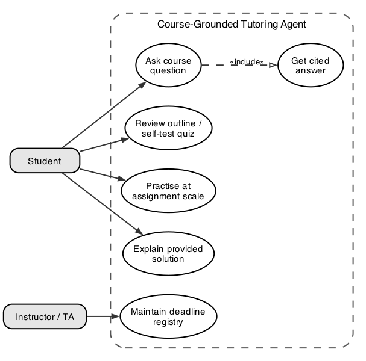
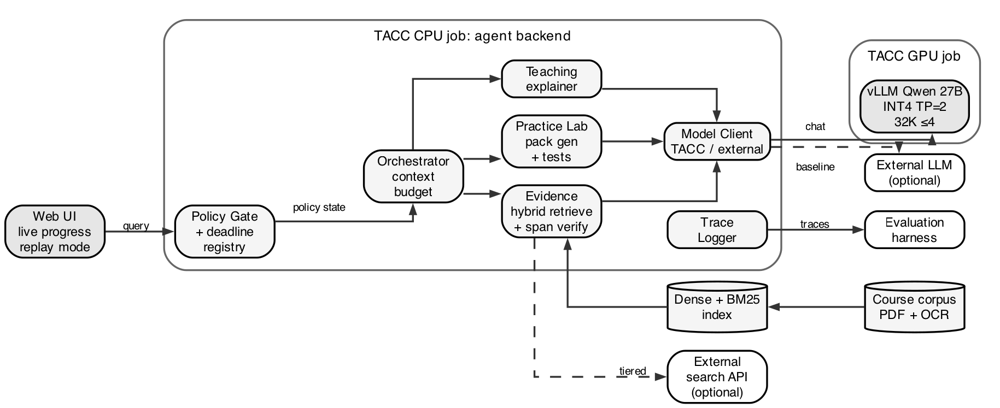

# Verifiable AI Tutoring on TACC

A course-grounded agent with evidence-checked answers, executable practice labs, and enforced course policy

LI Jinchuan · TIAN Yujia · XIE Yifeng · October 27, 2026

CSIT6000V — Advanced AI Computing and Systems · Fall 2026

## 1. Motivation and Problem

In CSIT6000V, students absorb dense lecture and tutorial material and then apply it in individual coding assignments, but support is uneven: TAs are scarce, and generic assistants cannot ground answers in the course’s own slides or respect its integrity rules. Answers are not verifiable against the slides, practice at assignment scale risks leaking solutions, and disclosure behaviour is left to a model’s discretion. We treat these as one systems problem: every output must be checkable — text claims against cited page spans, code artifacts against executable tests, and disclosure against a dated policy (Figure 1). The scenario is deliberately narrow: one course’s own materials, assignments, and deadlines.

## 2. Task Definition and Outputs

Two actors use the agent. A student can (i) ask course questions and receive an answer that cites the exact page and quoted span; (ii) request a review outline or a self-test quiz on a topic; (iii) practise with a generated exercise at the scale and environment of the corresponding assignment, receiving a reference solution, tests, and a stepwise explanation; and (iv) submit their own solution and receive line-anchored teaching. An instructor or TA maintains the deadline registry.

Disclosure follows a five-state policy: pre-release, active, extension window, post-deadline, and unknown. Before the deadline the agent refuses complete homework solutions and offers hints; it explains user-provided solutions only at the level of what was provided and never fills in missing parts; after the deadline it replaces refusal with full teaching and a verified solution. Insufficient evidence leads to abstention, not guessing.

## 3. Proposed System

Figure 2 shows the containers. A browser UI talks to an agent backend submitted as a TACC CPU job, which calls the course Qwen service on a GPU job through a model-client abstraction.

Evidence. Course PDFs are parsed with an OCR stage chosen during week one (existing transcripts as fallback) into page- and section-aware chunks, indexed by dense embeddings (computed in batches and cached; model chosen during week one) and BM25; retrieval fuses both and reranking is optional. A deterministic verifier then checks that every quoted span occurs on its cited page, triggering one repair round or abstention.

Artifacts. A practice pack mirrors the target assignment’s environment — first pack: MPI/GEMM with the same toolchain, Makefile, public datasets and sdk-test-style harness. A generated reference solution is accepted only after it compiles and passes the pack’s tests, so practice answers are verified rather than asserted. Later assignments add packs; GPU packs are verified in a batch window and cached.

Policy. The gate is code, not a prompt: a versioned registry stores each assignment’s release and due dates with extensions, an intent classifier routes requests, and every decision is logged. This makes disclosure testable and resistant to prompt injection.

Teaching. Explanations cite the artifacts they teach — page spans, code lines, test outcomes — and never invent missing content before the deadline.

Deployment. The model client keeps the TACC service primary (vLLM, Qwen3.8-27B-AWQ-INT4, TP=2, 32K context, at most four concurrent requests); external LLM and search APIs are optional, labelled, and cached for baselines. Traces, tests, and results follow the required execution path from task to visible result.

## 4. Evaluation Plan

We ask four questions on an in-repository benchmark. RQ1 evidence fidelity: citation span accuracy (deterministic) and faithfulness (human-checked support rate). RQ2 practice verifiability: the share of generated exercises whose reference solution compiles and passes course-style tests, plus environment alignment and cost per exercise. RQ3 disclosure correctness: behaviour across the five policy states, including a deadline extension, and an adversarial set of false “deadline passed” claims, TA impersonation, role-play, and pasted “official” solutions, compared with a prompt-only policy baseline. RQ4 cost: end-to-end latency, model calls per request, and a retrieval ablation over BM25, dense, and hybrid variants.

The benchmark holds fifty course questions, ten policy scenarios, and two practice packs; later-released sessions are held out as unseen data. Ablations isolate the span verifier, the code-level gate, and the hybrid index. Failure analysis groups errors by cause — OCR corruption, figure-only slides, retrieval misses, context overflow in long sessions, test-failing generated solutions, and policy bypasses — and analyses the dominant mode. Runs are reproducible with temperature 0, cached retrieval snapshots and responses, and an injected clock for policy tests.

## 5. Milestones

Four one-week workstreams move from infrastructure to full evaluation (Table 1); deliverables are the code repository, evaluation report, and demo.

| Workstream | W1 | W2 | W3 | W4 |
|---|---|---|---|---|
| Corpus and OCR pipeline | X |   |   |   |
| Hybrid index and retrieval | X | X |   |   |
| Span verifier |   | X |   |   |
| Policy engine and registry |   | X | X |   |
| Practice pack and tests |   |   | X |   |
| Explainer |   |   | X |   |
| UI and replay mode |   |   | X | X |
| Evaluation, report, demo |   |   |   | X |

## 6. Risks and Mitigation

OCR and embedding choices are unsettled: existing transcripts and cached embeddings bound the risk. The assignment toolchain may not be reachable from the project client job: week-one validation with a documented fallback. GPU pack verification competes with model serving: dedicated batch windows. External APIs add cost and availability risk: optional, cached, and never primary. Assignments may be reused across years: the registry is configurable and defaults conservative. Prompt injection: a code-level gate plus adversarial tests.

## References

[1] Course Project Brief, CSIT6000V Advanced AI Computing and Systems, Fall 2026.
[2] TACC@HKUST Public Environment Guide, CSIT6000V, Fall 2026.
[3] S. Robertson and H. Zaragoza. The Probabilistic Relevance Framework: BM25 and Beyond. Foundations and Trends in Information Retrieval, 3(4):333–389, 2009. doi:10.1561/1500000019.
[4] Assignment 1: MPI Programming, CSIT6000V, Fall 2026.
