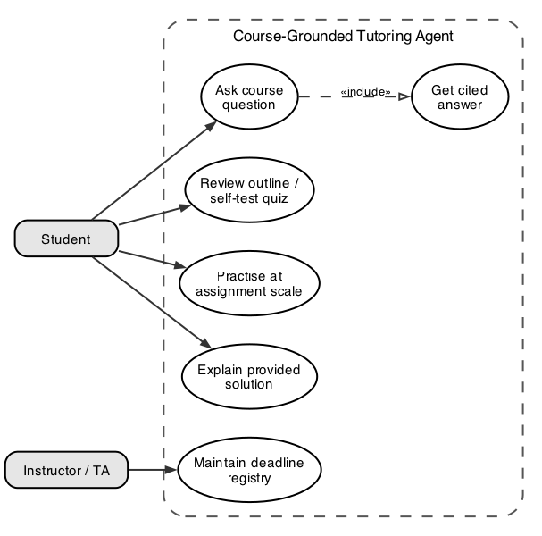
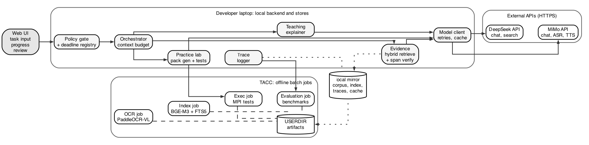

# Verifiable AI Tutoring on TACC

A course-grounded agent with evidence-checked answers, executable practice labs, and enforced course policy

LI Jinchuan (21188271) · TIAN Yujia (21201619) · XIE Yifeng (21322152) · October 30, 2026 (revision 2)

CSIT6000V · Advanced AI Computing and Systems · Fall 2026

## 1. Motivation and Problem

In CSIT6000V, students absorb dense lecture and tutorial material and then apply it in individual coding assignments, but support is uneven: TAs are scarce, and generic assistants cannot ground answers in the course’s own slides or respect its integrity rules. Answers are not verifiable against the slides, practice at assignment scale risks leaking solutions, and disclosure behaviour is left to a model’s discretion. We treat these as one systems problem: every output must be checkable, with text claims checked against cited page spans, code artifacts against executable tests, and disclosure against a dated policy (Figure 1). The scenario is deliberately narrow: one course’s own materials, assignments, and deadlines.

## 2. Task Definition and Outputs

Two actors use the agent. A student can (i) ask course questions and receive an answer that cites the exact page and quoted span; (ii) request a review outline or a self-test quiz on a topic; (iii) practise with a generated exercise at the scale and environment of the corresponding assignment, receiving a reference solution, tests, and a stepwise explanation; (iv) submit their own solution and receive line-anchored teaching; and (v) ask by voice, attach audio, and play spoken answers through the MiMo audio models. An instructor or TA maintains the deadline registry.

Disclosure follows a five-state policy: pre-release, active, extension window, post-deadline, and unknown. Before the deadline the agent refuses complete homework solutions and offers hints; it explains user-provided solutions only at the level of what was provided and never fills in missing parts; after the deadline it replaces refusal with full teaching and a verified solution. Insufficient evidence leads to abstention, not guessing.

## 3. Proposed System

Figure 2 shows the containers. A React browser UI talks to a FastAPI agent backend on the developer laptop, which runs a typed LangGraph workflow, calls external OpenAI-compatible model APIs, and reads a local mirror of the OCR pages and index vectors that TACC produces offline. The required execution path, from task to visible result, runs on the laptop: enter the task, watch progress, and review the answer with its evidence.

Evidence. Course PDFs are parsed by a TACC OCR batch job with PaddleOCR-VL into page records with page numbers, block boxes, and page images; the week-one OCR and whole-PDF parse spikes passed before this revision. Page- and section-aware chunks are embedded with BGE-M3 in a TACC index job and indexed with BM25; both artifacts are downloaded into the laptop mirror. A deterministic verifier checks that every quoted span occurs on its cited page, triggering one repair round or abstention.

Artifacts. A practice pack mirrors the target assignment environment: MPI/GEMM with the same toolchain, Makefile, public datasets, and sdk-test-style harness. A generated reference solution is accepted only after it compiles and passes the pack tests in a TACC execution job, and verified answers are cached. A CUDA attention pack is best effort (P2).

Policy. The gate is code, not a prompt: the agent runs as a typed LangGraph StateGraph over typed tools with no generic shell; a versioned registry stores each assignment release and due dates with extensions, an intent classifier routes requests, and every decision is logged. This makes disclosure testable and resistant to prompt injection.

Teaching and work chain. Explanations cite the artifacts they teach, page spans, code lines, and test outcomes, and never invent missing content before the deadline; the work chain and its JSONL trace expose each step for review and replay.

Deployment. Text generation uses external OpenAI-compatible APIs (DeepSeek primary; MiMo selectable for chat, audio, and speech) with same-model retries and no automatic cross-model fallback; every call is labelled and cached. TACC is an offline compute resource: submitted batch jobs produce the OCR records, the embedding index, execution results, and evaluation evidence, and each job exits when finished. No service is hosted on TACC; the course Qwen model is an optional offline batch baseline. JSONL traces remain canonical.

*The models, services, and batch layout named here reflect the current plan and may change as development proceeds.*

## 4. Evaluation Plan

We ask four questions on an in-repository benchmark. This is a task-oriented project: it targets tutoring-task performance against baselines (an external chatbot for the self-test loop, a prompt-only policy for disclosure), with latency and cost reported as secondary metrics (RQ4). RQ1 evidence fidelity: citation span accuracy (deterministic) and human-checked faithfulness. RQ2a asks whether generated questions have reference answers that compile and pass course-style tests and cite the material; RQ2b compares the agent's grading agreement with developer ground truth and the chatbot baseline, with a capability gap table. RQ3 disclosure correctness covers the five policy states, a deadline extension, and adversarial cases: false deadline claims, TA impersonation, role-play, and pasted official solutions. RQ4 reports latency, model calls per request, and a BM25, dense, and hybrid ablation.

The benchmark holds fifty course questions, ten policy scenarios, one MPI/GEMM practice pack, and a shared self-test grading set; later-released sessions are held out. Failure analysis groups errors by cause: OCR corruption, figure-only slides, retrieval misses, context overflow, test-failing generated solutions, and policy bypasses, and analyses the dominant mode. Runs use temperature 0, cached retrieval snapshots, and an injected clock.

## 5. Milestones

Four one-week workstreams move from infrastructure to full evaluation (Table 1). Deliverables are the code repository, evaluation report, tested demo, and final presentation.

| Workstream | W1 | W2 | W3 | W4 |
|---|---|---|---|---|
| Corpus and OCR pipeline | X |   |   |   |
| Hybrid index and retrieval | X | X |   |   |
| Span verifier |   | X |   |   |
| Policy engine and registry |   | X | X |   |
| Practice pack and tests |   |   | X |   |
| Explainer |   |   | X |   |
| UI and replay mode |   |   | X | X |
| Evaluation, report, demo |   |   |   | X |

## 6. Risks and Mitigation

TACC batch work is queue-bound and capped at one hour: schedule corpus, index, and execution jobs early, keep them resumable, and cache their outputs. External APIs add cost and availability risk: calls are labelled, cached, and retried only on the same model, so no rerun needs a paid call. The live demo depends on the laptop: a documented runbook and a replay fallback cover a machine or network failure. OCR quality is checked against page images, and prompt injection is handled by the code-level gate plus adversarial tests.

## References

[1] Course Project Brief and staff clarifications, CSIT6000V, Fall 2026.
[2] TACC@HKUST Public Environment Guide, CSIT6000V, Fall 2026.
[3] S. Robertson and H. Zaragoza. The Probabilistic Relevance Framework: BM25 and Beyond. Found. Trends Inf. Retr., 3(4):333-389, 2009. doi:10.1561/1500000019.
[4] Assignment 1: MPI Programming, CSIT6000V, Fall 2026.
