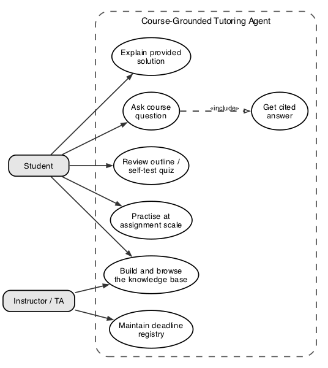
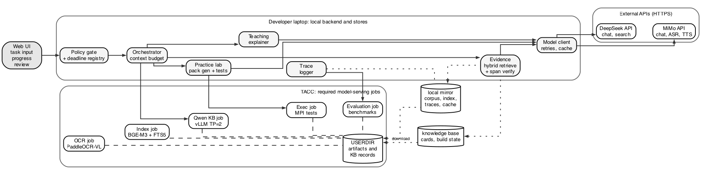

# Verifiable AI Tutoring on TACC

A course-grounded agent with evidence-checked answers, executable practice labs, and enforced course policy

LI Jinchuan (21188271) · TIAN Yujia (21201619) · XIE Yifeng (21322152) · November 1, 2026

CSIT6000V · Advanced AI Computing and Systems · Fall 2026

## 1. Motivation and Problem

In CSIT6000V, students absorb dense lecture and tutorial material and then apply it in individual coding assignments, but support is uneven: TAs are scarce, and generic assistants cannot ground answers in the course’s own slides or respect its integrity rules. Answers are not verifiable against the slides, practice at assignment scale risks leaking solutions, and disclosure behaviour is left to a model’s discretion. We treat these as one systems problem: every output must be checkable, with text claims checked against cited page spans, code artifacts against executable tests, and disclosure against a dated policy (Figure 1). The scenario is deliberately narrow: one course’s own materials, assignments, and deadlines.

## 2. Task Definition and Outputs

Two actors use the agent. A student can (i) ask course questions and receive an answer that cites the exact page and quoted span; (ii) request a review outline or a self-test quiz on a topic; (iii) practise with a generated exercise at the scale and environment of the corresponding assignment, receiving a reference solution, tests, and a stepwise explanation; (iv) submit their own solution and receive line-anchored teaching; (v) ask by voice, attach audio, and play spoken answers through the MiMo audio models; and (vi) browse the course knowledge base that TACC enriches offline. An instructor or TA maintains the deadline registry and triggers knowledge-base builds.

Disclosure follows a five-state policy: pre-release, active, extension window, post-deadline, and unknown. Before the deadline the agent refuses complete homework solutions and offers hints; it explains user-provided solutions only at the level of what was provided and never fills in missing parts; after the deadline it replaces refusal with full teaching and a verified solution. Insufficient evidence leads to abstention, not guessing.

## 3. Proposed System

Figure 2 shows the containers. A React browser UI talks to a FastAPI agent backend on the developer laptop, which runs a typed LangGraph workflow and calls external OpenAI-compatible APIs for interactive answers. TACC is a required model-serving backend: submitted GPU jobs run the embedding model and Qwen text processing; the backend submits a job, waits for its result, and uses it. The required execution path, from task to visible result, runs on the laptop: enter the task, watch progress, and review the answer with its evidence.

Evidence. Course PDFs are parsed by a TACC OCR job with PaddleOCR-VL into page records with block boxes and page images. Page-aware chunks are embedded with BGE-M3 and indexed with BM25 in a TACC job; the artifacts are downloaded to the laptop. A deterministic verifier checks every quoted span against its cited page, with one repair round or abstention.

Knowledge base. Qwen on TACC is an offline text-processing backend: one submitted GPU job per build shard reads course chunks from USERDIR, generates cited knowledge cards (summary, key concepts, study questions) as JSONL, and exits. The local backend polls, downloads, validates, and stores the records; no port forwarding or inbound service is used.

Artifacts. The MPI/GEMM practice pack mirrors the assignment toolchain, Makefile, datasets, and test harness; a generated reference solution is accepted only after it compiles and passes the pack tests in a TACC execution job. A CUDA pack is best effort (P2).

Policy. The gate is code, not a prompt: a typed LangGraph StateGraph over typed tools, a versioned deadline registry, an intent classifier, and a decision log make disclosure testable and resistant to prompt injection; explanations cite page spans, code lines, or test outcomes.

Deployment. Interactive text generation uses external APIs (DeepSeek primary; MiMo selectable) with same-model retries and caching. TACC model serving is required and batched: the embedding index and Qwen knowledge-base jobs are reached only through job submission, and their outputs are downloaded and cached; no SSH forwarding or inbound service is used.

*Models, service versions, and batch sizes may change; the required TACC model-serving path and job-submission access are fixed.*

## 4. Evaluation Plan

We ask four questions on an in-repository benchmark. This is a task-oriented project: it targets tutoring-task performance against baselines (an external chatbot for the self-test loop, a prompt-only policy for disclosure), with efficiency as a secondary metric (RQ4). RQ1 tests citation accuracy and faithfulness; RQ2a tests reference answers that compile and pass course-style tests; RQ2b compares grading agreement with developer ground truth and the chatbot; RQ3 covers five policy states and adversarial cases; RQ4 reports latency, model calls, and the BM25, dense, and hybrid ablation.

The benchmark holds fifty course questions, ten policy scenarios, one MPI/GEMM pack, and a shared grading set. The required TACC workflow is demonstrated end to end: one knowledge-base build job per document batch is submitted, its JSONL records are downloaded and validated, and the resulting knowledge base feeds a review outline; the report records queue, cold-start, build time, and schema validity. Failure analysis groups errors by cause: OCR corruption, figure-only slides, retrieval misses, context overflow, test-failing generated solutions, policy bypasses, and malformed Qwen records.

## 5. Milestones

Four one-week workstreams move from infrastructure to full evaluation (Table 1). Deliverables are the code repository, evaluation report, tested demo, and final presentation; the demo includes a TACC Qwen knowledge-base build used by the agent.

| Workstream | W1 | W2 | W3 | W4 |
|---|---|---|---|---|
| Corpus and OCR pipeline | X |   |   |   |
| Hybrid index and retrieval | X | X |   |   |
| Span verifier |   | X |   |   |
| Policy engine and registry |   | X | X |   |
| Practice pack and tests |   |   | X |   |
| Explainer |   |   | X |   |
| UI and replay mode |   |   | X | X |
| Evaluation, report, demo |   |   |   | X |

## 6. Risks and Mitigation

TACC jobs are queue-bound and capped at one hour: schedule the embedding and knowledge-base jobs early, shard by document, keep them resumable, and pre-build the demo knowledge base. Qwen output can be malformed: records are schema-validated and repaired once. External APIs add cost and availability risk: calls are labelled, cached, and retried only on the same model. A laptop failure is covered by the runbook and replay fallback; OCR quality is spot-checked, and prompt injection is handled by the gate plus adversarial tests.

## References

[1] Course Project Brief and staff clarifications (2026-10-28, 2026-10-30, 2026-11-01), CSIT6000V, Fall 2026.
[2] TACC@HKUST Public Environment Guide, CSIT6000V, Fall 2026.
[3] S. Robertson and H. Zaragoza. The Probabilistic Relevance Framework: BM25 and Beyond. Found. Trends Inf. Retr., 3(4):333-389, 2009. doi:10.1561/1500000019.
[4] Assignment 1: MPI Programming, CSIT6000V, Fall 2026.
